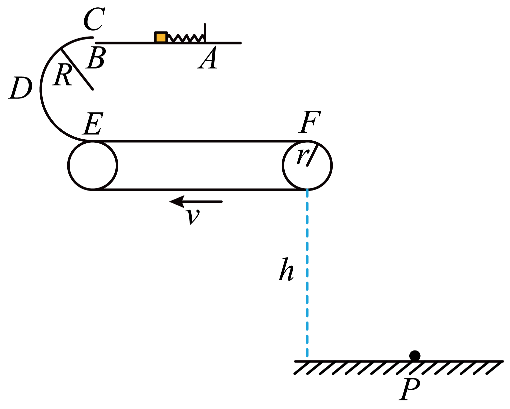

# Physics - 题目 679

**ID**: 3bf9cc240b2a44baa3f009a7734f43a2
**年级**: Grade 12
**难度**: Medium
**题型**: Calculation

## 题目
如图所示，竖直平面内有水平光滑直轨道AB，轨道左侧有一竖直光滑半圆轨道CDE，其半径 $R=0.2{\rm{m}}$ ，最低点E与水平传送带平滑连接。​​​​​​​‌现一质量为 $m=10{\rm{g}}$ 、可视为质点的滑块压缩弹簧（滑块与弹簧不相连），静止释放后滑块沿轨道ABCDE运动，BC之间有小缝可供滑块通过，然后滑上传送带，最后落在水平地面P点。滑块与传送带之间的动摩擦因数 $μ=0.4$ ，传送带的EF长度 $L=0.6{\rm{m}}$ ，传送带轮子的半径 $r=0.1{\rm{m}}$ ，传送带以 $v=4{\rm{m}}/{\rm{s}}$ 的速度顺时针匀速转动，传送带下表面离地面高度 $h=0.6{\rm{m}}$ 。某次释放滑块时弹簧的弹性势能 $E{{}_{{\rm{p}}}}=0.02{\rm{J}}$ ，取 $g=10{\rm{m}}/{\rm{s}}{{}^{2}}$ 。求：（1）滑块运动到E点时对轨道的压力大小；（2）落地点P离开传送带右端的水平距离 $Δ{\rm{x}}$ ；（3）若要使滑块的落地点在同一位置，弹性势能的取值范围是多少？

## 解答

1. （1）根据机械能守恒
2. $E{{}_{{\rm{p}}}}+mg\times 2R=\frac {1}{2}mv{{}_{E}^{2}}$
3. 滑块运动到E点时，设轨道对滑块的支持力N，根据牛顿第二定律
4. $N-mg=m\frac {v{{}_{E}^{2}}}{R}$
5. 代入数据联立得
6. $v{{}_{E}}=2\sqrt {3}{\rm{m}}{\rm{/}}{\rm{s}}$
7. N=0.7N
8. 根据牛顿第三定律，滑块对轨道的压力大小
9. N_{1}=0.7N
10. （2）滑块在传送带上加速度大小
11. $a=μg=4{\rm{m}}{\rm{/}}{\rm{s}}{{}^{2}}$
12. 根据
13. $v{{}^{2}}-v{{}_{E}^{2}}=2as$
14. 解得，滑块加速度到速度 $v=4{\rm{m}}/{\rm{s}}$ 时位移
15. s=0.5m
16. 所以滑块运动到F点速度
17. $v{{}_{F}}=v=4{\rm{m}}/{\rm{s}}$
18. 此后做平抛运动，根据
19. $h+2r=\frac {1}{2}gt{{}^{2}}$
20. 解得
21. t=0.4s
22. 落地点P离开传送带右端的水平距离
23. $Δx=v{{}_{F}}t=1.6{\rm{m}}$
24. （3）若要使滑块的落地点在同一位置，则滑块运动到F点速度
25. $v{{}_{F}}=v=4{\rm{m}}/{\rm{s}}$
26. 当在传送带上加速运动时，有
27. $v{{}^{2}}-v{{}_{E}^{^{′}2}}=2aL$
28. $E{{}_{{\rm{p}}{\rm{1}}}}+mg\times 2R=\frac {1}{2}mv{{}_{E}^{^{′}2}}$
29. 解得
30. $E{{}_{{\rm{p}}{\rm{1}}}}=0.016{\rm{J}}$
31. 当在传送带上减速运动时，有
32. $v{{}_{E}^{^{′}2}}-v{{}^{2}}=2aL$
33. $E{{}_{{\rm{p}}{\rm{1}}}}+mg\times 2R=\frac {1}{2}mv{{}_{E}^{^{′}2}}$
34. 解得
35. $E{{}_{{\rm{p}}{\rm{1}}}}\leqslant 0.064{\rm{J}}$
36. 所以弹性势能的取值范围是
37. $0.016{\rm{J}}\leqslant E{{}_{{\rm{p}}}}\leqslant 0.064{\rm{J}}$

## 知识点

**中文**:
  - 传送带模型
  - 求解平抛运动、类平抛运动问题
  - 竖直面内圆周运动问题
  - 功能原理、能量守恒与曲线运动的综合

**English**:
  - Conveyor Belt Model
  - Solving Horizontal and Quasi-Horizontal Projectile Problems
  - Circular Motion in Vertical Plane
  - Energy Conservation in Curvilinear Motion

---
