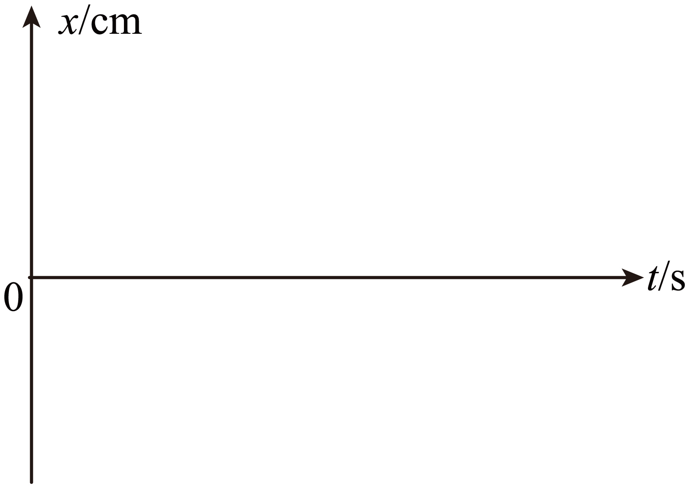

# Physics - 题目 276

**ID**: 4345c0922a77455986bc811a0e73f554
**年级**: Grade 12
**难度**: Medium
**题型**: Calculation

## 题目
有一弹簧振子在水平方向上的B、C之间做简谐运动，已知B、C间的距离为20cm，振子在2s内完成了10次全振动。​​​​​​​‌若从某时刻振子经过平衡位置时开始计时（t=0），经过 $\frac {1}{4}$ 周期振子有正向最大加速度。(1)求振子的振幅和周期；(2)在图中作出该振子的位移时间图像；(3)写出振子的振动方程。

## 解答

1. （1）由题可知，振幅 $A=10{\rm{c}}{\rm{m}}$ ，周期为 $T=\frac {2}{10}{\rm{s}}=0.2{\rm{s}}$
2. （2）振子在 $\frac {1}{4}$ 周期时具有正向最大加速度，有负向最大位移，其位移时间图像如图所示
3. 
4. （3）设振动方程为 $x=A\sin (ωt+φ)$ ，当t=0时，x=0，则 $\sin φ=0$ ，解得 $φ=π$ 或 $φ=0$ （舍去），所以振动方程为 $x=10\sin (10πt+π){\rm{c}}{\rm{m}}$

## 知识点

**中文**:
  - 振幅、周期、频率、相位和波长及其计算
  - 简谐运动的函数与图像

**English**:
  - Calculation of Amplitude, Period, Frequency, Phase, and Wavelength
  - Functions and Graphs of SHM

---
