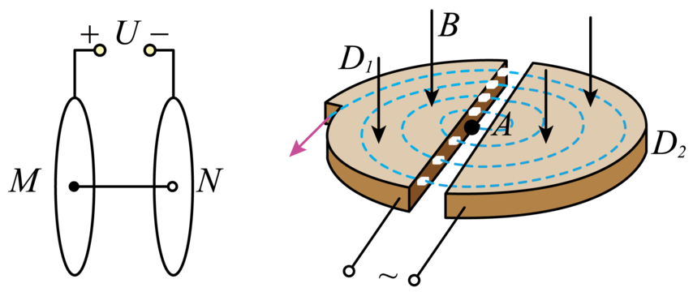

# Physics - 题目 1662

**ID**: 59a9f41dd43a4341a782577e750a94c2
**年级**: Grade 12
**难度**: Medium
**题型**: Calculation

## 题目
现代科学研究中常用到高能粒子，产生这些高能粒子的“工厂”就是各种各样的粒子加速器。​​​​​​​‌（1）如图所示，真空中平行金属板M、N之间所加电压为U，一个质量为m、电荷量为 $+q$ 的粒子从M板由静止释放，经电场加速后到达N板，不计带电粒子的重力。求带电粒子到达N板时的速度大小v。（2）1930年，物理学家劳伦斯设计出了回旋加速器，其工件原理如图所示。半径为R的高真空的D形金属盒处在匀强磁场中，磁感应强度大小为B，方向与盒面垂直。将两盒与电压为U的高频交流电源相连，两盒的狭缝间形成周期性变化的电场。A处粒子源产生的带电粒子，质量为m、电荷量为 $+q$ ，初速度忽略不计。调整交流电源的频率可使粒子每次通过狭缝时都能被加速。不计带电粒子穿过狭缝的时间和粒子所受重力。a．求所用交流电源的频率f；b．对于用回旋加速器加速带电粒子，甲、乙两位同学有不同的看法：甲同学认为增大交流电源的电压U，就能得到更大能量的粒子；乙同学认为增大D形盒的半径R，就能得到更大能量的粒子。忽略相对论效应。你认为哪位同学的看法合理？简要说明理由。

## 解答

1. （1）带电粒子从M板由静止释放加速到N板的过程，根据动能定理，有
2. $qU=\frac {1}{2}mv{{}^{2}}-0$
3. 带电粒子到达N板时的速度大小为
4. $v=\sqrt {\frac {2qU}{m}}$
5. （2）a．根据回旋加速器的工作原理可知，交流电源的频率与粒子做圆周运动的频率相同
6. $f=\frac {1}{T}=\frac {qB}{2πm}$
7. b．乙同学的看法合理；
8. 理由是：粒子的速度与半径成正比，所以当圆周运动的半径最大时，粒子的动能最大，则有
9. $qvB=m\frac {v{{}_{m}^{2}}}{R}$
10. 解得
11. $E{{}_{km}}=\frac {1}{2}mv{{}_{m}^{2}}=\frac {q{{}^{2}}B{{}^{2}}R{{}^{2}}}{2m}$
12. 所以增大交流电源的电压U，不能得到更大能量的粒子；增大D形盒的半径R，能得到更大能量的粒子。

## 知识点

**中文**:
  - 回旋加速器

**English**:
  - Cyclotron

---
