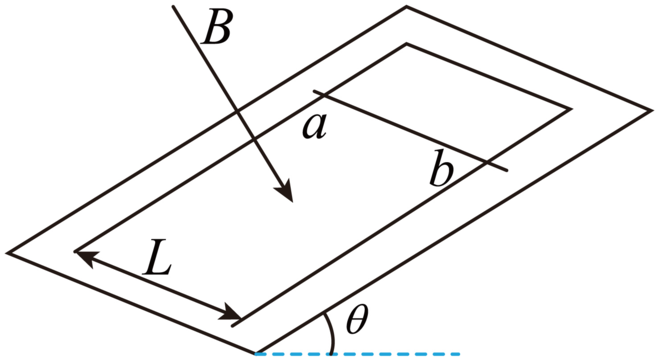

# Physics - 题目 1970

**ID**: 647ae54229834c88b86099c9575a0002
**年级**: Grade 12
**难度**: Medium
**题型**: Calculation

## 题目
如图所示，一个U形光滑金属框架开口向下，固定于倾角为 $θ=53{^{\circ }}$ 的斜面上，框架的宽度 $L=1.0\mathrm{\;}{\rm{m}}$ 。​​​​​​​‌现将一根长度略大于框架宽度的金属条放置于框架上由静止释放，已知金属条的质量 $m=2.0\mathrm{\;}{\rm{k}}{\rm{g}}$ 、电阻 $R=2\mathrm{\;}{\rm{Ω}}$ ，其余电阻均不计，在金属条释放瞬间沿垂直斜面向下的方向施加一磁感应强度大小为 $B=4.0\mathrm{\;}{\rm{T}}$ 的匀强磁场。金属条从静止下滑1.0 m时速度达到1.6 m/s，从释放到通过金属条的电荷量 $q=4.0\mathrm{\;}{\rm{C}}$ 时恰好达到稳定状态。重力加速度 $g=10\mathrm{\;}{\rm{m}}{\rm{/}}{\rm{s}}{^{{{2}}}}$ ， $\sin 53{^{\circ }}=0.8$ ， ${\cos}53{^{\circ }}=0.6$ 。求：（1）金属条从释放到达到稳定状态过程中回路产生的焦耳热；（2）金属条下滑1.0 m运动的时间。

## 解答

1. （1）设金属条从释放到通过其的电荷量 $q=4.0\mathrm{\;}{\rm{C}}$ 的过程中，金属条下滑的位移大小为 $x{{}_{1}}$ ，时间为 $Δt$ ，则有 $q=\bar I{\rm{Δ}}t$ ， $\bar I=\frac {\bar E}{R}$ ， $\bar E=\frac {{\rm{Δ}}Φ}{{\rm{Δ}}t}=\frac {BLx{{}_{1}}}{{\rm{Δ}}t}$ ，
2. 整理有 $q=\frac {BLx{{}_{1}}}{R}$ ，
3. 得 $x{{}_{1}}=\frac {qR}{BL}=\frac {4\times 2}{4\times 1}\mathrm{\;}{\rm{m}}=2\mathrm{\;}{\rm{m}}$ ，
4. 因金属条恰好达到稳定状态，则有 $mg\sin θ=BIL$ ， $I=\frac {BLv{{}_{1}}}{R}$ ，
5. 联立并代入数据可得 $v{{}_{1}}=2\mathrm{\;}{\rm{m}}{\rm{/}}{\rm{s}}$ ，
6. 设整个过程回路产生的焦耳热为Q，根据动能定理可得 $mg\sin θ\cdot x{{}_{1}}-Q=\frac {1}{2}mv{{}_{1}^{2}}$ ，
7. 代入数值得 $Q=28\mathrm{\;}{\rm{J}}$ 。
8. （2）金属条下滑位移大小 $x{{}_{2}}=1.0\mathrm{\;}{\rm{m}}$ 时的速度大小为 $v{{}_{2}}=1.6\mathrm{\;}{\rm{m}}{\rm{/}}{\rm{s}}$ ，设该过程运动时间为t，对金属条由动量定理有，
9. 其中， $q^{′}=\frac {BLx{{}_{2}}}{R}$ ，
10. 可得 $q^{′}=2\mathrm{\;}{\rm{C}}$ ，
11. 综合可得 $t=0.7\mathrm{\;}{\rm{s}}$ 。

## 知识点

**中文**:
  - 电磁感应现象中的功能问题

**English**:
  - Work-Energy Problems in EM Induction

---
