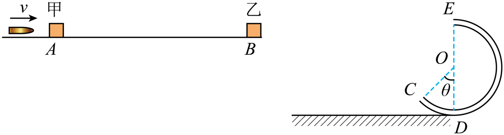

# Physics - 题目 2415

**ID**: 6f8215f42fc24e3aa7ae7c704c587f48
**年级**: Grade 12
**难度**: Medium
**题型**: Calculation

## 题目
如图所示，距离地面一定高度的水平桌面上，有两相同材料做成的物块甲、乙，质量分别为 $m{{}_{1}}=0.49{\rm{k}}{\rm{g}}、m{{}_{2}}=1.0{\rm{k}}{\rm{g}}$ ，两物块与水平桌面间的动摩擦因数为 $μ=0.5$ ，物块乙放在桌面边缘的B点，物块甲放在物块乙左侧的A点， $AB=6{\rm{m}}$ 。​​​​​​​‌在水平地面上固定一半径为 $R=1.25{\rm{m}}$ 的竖直光滑圆管轨道，轨道与水平地面相切于D点，直径DE垂直水平面，C为圆管的入口，其中 $θ=37{}\degree $ 。质量为 $m{{}_{0}}=10{\rm{g}}$ 的子弹以水平向右的速度 $v=800{\rm{m}}/{\rm{s}}$ 射入物块甲并留在其中（时间极短），经过一段时间与物块乙发生碰撞，碰后甲被反弹且物块甲、乙的速度大小之比为 $1:4$ ，物块乙无碰撞地进入圆管。假设两物块均可视为质点且碰撞时间极短，重力加速度g取 $10{\rm{m}}/{\rm{s}}{^{2}}$ ， ${\rm{s}}{\rm{i}}{\rm{n}}37{}\degree =0.6$ 。求：(1)碰后物块甲、乙的速度大小；(2) $B、C$ 两点的水平间距：(3)物块乙运动到D点时对圆管的压力大小。

## 解答

1. （1）子弹击中物块甲的过程中，子弹与物块甲组成的系统动量守恒
2. 由动量守恒定律得 $m{{}_{0}}v=\left ({m{{}_{0}}+m{{}_{1}}}\right )v{{}_{A}}$
3. 解得 $v{{}_{A}}=16{\rm{m}}/{\rm{s}}$
4. 物块甲从 $\mathrm{A}$ 到 $B$ 的过程，由动能定理 $-μ\left ({m{{}_{0}}+m{{}_{1}}}\right )gx{{}_{AB}}=\frac {1}{2}\left ({m{{}_{0}}+m{{}_{1}}}\right )v{{}_{B}^{2}}-\frac {1}{2}\left ({m{{}_{0}}+m{{}_{1}}}\right )v{{}_{A}^{2}}$
5. 解得 $v{{}_{B}}=14{\rm{m}}/{\rm{s}}$
6. 两物块碰撞的过程动量守恒，设碰后物块甲，乙的速度大小分别为 $v{{}_{1}}、v{{}_{2}}$ ，又由动量守恒定律得 $\left ({m{{}_{0}}+m{{}_{1}}}\right )v{{}_{B}}=-\left ({m{{}_{0}}+m{{}_{1}}}\right )v{{}_{1}}+m{{}_{2}}v{{}_{2}}$
7. 解得 $v{{}_{1}}=2{\rm{m}}/{\rm{s}}，v{{}_{2}}=8{\rm{m}}/{\rm{s}}$
8. （2）物块乙离开 $B$ 点后做平拋运动，设运动到 $C$ 点的速度为 $v{{}_{c}}$ ，由于物块乙无碰撞地进入圆管
9. 则有 $v{{}_{2}}=v{{}_{c}}{\cos}37{}\degree $
10. 解得 $v{{}_{c}}=10{\rm{m}}/{\rm{s}}$
11. 物块乙在 $C$ 点的竖直分速度大小为 $v{{}_{y}}=v{{}_{c}}\sin 37{}\degree =6{\rm{m}}/{\rm{s}}$
12. 物块从 $B$ 到 $C$ 的时间为 $t=\frac {v{{}_{y}}}{g}=0.6{\rm{s}}$
13. $BC$ 两点间的水平距离为 $x{{}_{BC}}=v{{}_{2}}t=4.8{\rm{m}}$
14. （3）滑块乙运动到 $D$ 点的速度为 $v{{}_{D}}$ ，由 $C$ 到 $D$ 的过程由机械能守恒定律得
15. $\frac {1}{2}m{{}_{2}}v{{}_{C}^{2}}+m{{}_{2}}gR\left ({1-{\cos}37{}\degree }\right )=\frac {1}{2}m{{}_{2}}v{{}_{D}^{2}}$
16. 滑块乙在 $D$ 点时，由牛顿第二定律得 $F{{}_{{\rm{N}}}}-m{{}_{2}}g=\frac {m{{}_{2}}v{{}_{D}^{2}}}{R}$
17. 解得 $F{{}_{{\rm{N}}}}=94{\rm{N}}$
18. 由牛顿第三定律，物块乙在 $D$ 点时对圆管的压力大小为94N。

## 知识点

**中文**:
  - 子弹-木块模型

**English**:
  - Bullet-Block Model

---
