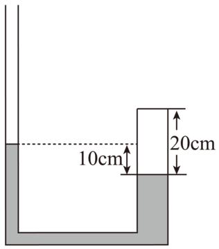

# Physics - 题目 2091

**ID**: 7761935e4cf042918ea95c5e9a4a5de2
**年级**: Grade 12
**难度**: Medium
**题型**: Calculation

## 题目
如图所示的U形玻璃管，左管开口，右管管口封闭，管中一段水银在右管中封闭了一段气柱，气柱高度为20 cm，左右两管中水银面的高度差为10 cm，左管水银柱的横截面积为1 cm^{2}，右管中水银柱的横截面积为2 cm^{2}。​​​​​​​‌已知环境温度为27 $^\circ {\rm{C}}$ ，大气压强为75 cmHg，左管足够长，右管中水银柱高度大于5 cm。（i）若在左管中缓慢倒入水银，使右管中气柱体积减少 $\frac {1}{6}$ ，求需要倒入水银的体积；（ii）若给右管中气柱缓慢加热，使左管中水银液面与右管顶端相平，求气柱需要升高的温度。

## 解答

1. （i）开始时，封闭气体的压强为：
2. $p{{}_{1}}=p{{}_{0}}+10{\rm{c}}{\rm{m}}{\rm{H}}{\rm{g}}=85{\rm{c}}{\rm{m}}{\rm{H}}{\rm{g}}$
3. 假设倒入水银后，右管中气体压强为 $p{{}_{2}}$ ，则理想气体发生等温变化，根据玻意尔定律：
4. $p{{}_{1}}h{{}_{1}}S{{}_{2}}=p{{}_{2}}\times \frac {5}{6}h{{}_{1}}S{{}_{2}}$
5. 解得： $p{{}_{2}}=102{\rm{c}}{\rm{m}}{\rm{H}}{\rm{g}}$
6. 左右管中液面的高度差为：
7. $Δh=(102-75){\rm{c}}{\rm{m}}=27{\rm{c}}{\rm{m}}$
8. 倒入水银的体积：
9. $V=\left ({17+\frac {20}{6}}\right ){\rm{c}}{\rm{m}}\times 1{\rm{c}}{\rm{m}}{^{2}}+\frac {20}{6}{\rm{c}}{\rm{m}}\times 2{\rm{c}}{\rm{m}}{^{2}}=27{\rm{c}}{\rm{m}}{^{3}}$ ；
10. （ii）若给右管中气柱缓慢加热，使左管中水银液面与右管管口相平，假设气柱升高温度为 $ΔT$ ，此时左管液面上升 $10{\rm{c}}{\rm{m}}$ ，右管中液面下降 $5{\rm{c}}{\rm{m}}$ ，则右管中气体压强：
11. $p{{}_{3}}=p{{}_{0}}+25{\rm{c}}{\rm{m}}{\rm{H}}{\rm{g}}=100{\rm{c}}{\rm{m}}{\rm{H}}{\rm{g}}$
12. 根据理想气体状态方程：
13. $\frac {p{{}_{1}}h{{}_{1}}S{{}_{2}}}{T{{}_{1}}}=\frac {p{{}_{3}}h{{}_{3}}S{{}_{2}}}{T{{}_{1}}+ΔT}$
14. 解得： $ΔT=141{\rm{K}}$ 。

## 知识点

**中文**:
  - 一定质量的气体多过程状态变化问题
  - 气体等温变化与玻意耳定律
  - 利用理想状态方程解决问题

**English**:
  - Multi-process State Changes of Fixed Mass Gas
  - Isothermal Change and Boyle's Law
  - Problem Solving using Ideal Gas Law

---
