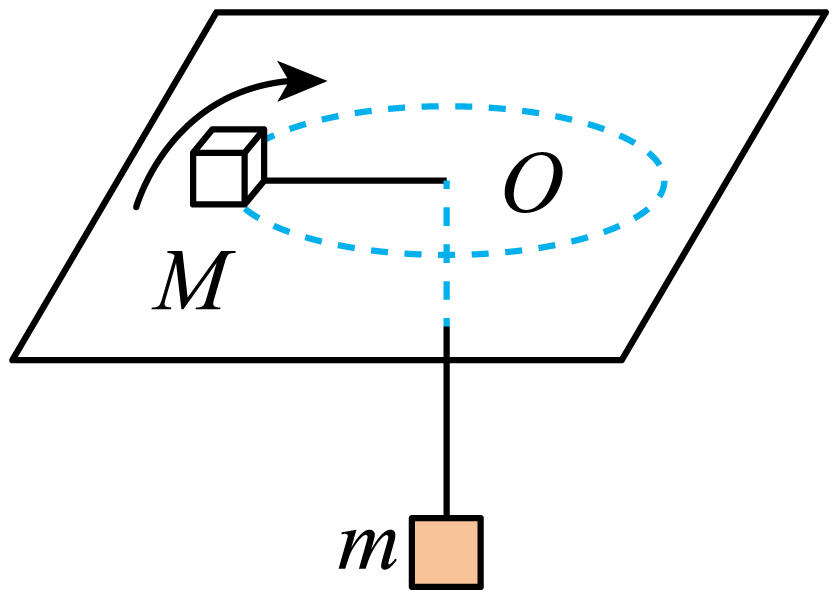

# Physics - 题目 2809

**ID**: 7c2a8d261fc546bbb50ebb9fee27f97c
**年级**: Grade 12
**难度**: Medium
**题型**: Calculation

## 题目
如图所示，用细绳一端系着的质量 $M=2{\rm{k}}{\rm{g}}$ 的物体A（可视为质点）静止在水平转盘上，细绳另一端通过转盘中心的光滑小孔O吊着质量 $m=0.2{\rm{k}}{\rm{g}}$ 的物块B，物体A到O点的距离为 $0.5{\rm{m}}$ 。​​​​​​​‌若物体A与转盘盘面间的动摩擦因数 $μ=0.2$ ，取重力加速度大小 $g=10{\rm{m}}{\rm{/}}{\rm{s}}{^{{{2}}}}$ ，已知最大静摩擦力和滑动摩擦力相等。（1）当转盘的角速度 $ω{{}_{1}}=2{\rm{r}}{\rm{a}}{\rm{d}}{\rm{/}}{\rm{s}}$ 时，物块B处于静止状态，此时求物体A受到的摩擦力大小及方向；（2）为使物块B保持静止，求转盘绕中心O旋转的角速度的取值范围（结果可含根号）。

## 解答

1. （1）小球 $B$ 始终静止，则 $T=mg$
2. 物体 $\mathrm{A}$ 做匀速圆周运动的向心力大小 $F{{}_{1}}=Mω{{}_{1}^{2}}r=4{\rm{N}}$ ，对物体 $\mathrm{A}$ 受力分析可知 $T+f{{}_{1}}=F{{}_{1}}$ ，解得 $f{{}_{1}}=2{\rm{N}}$ ，摩擦力方向沿绳指向圆心O；
3. （2）角速度取最大值时，物体 $\mathrm{A}$ 需要的向心力由绳的拉力和最大静摩擦力的合力提供，则 $T+f{{}_{{\rm{m}}}}=Mω{{}_{1}^{2}}r$ ，又 $f{{}_{{\rm{m}}}}=μMg=4{\rm{N}}$ ，解得 $ω{{}_{2}}=\sqrt {6}{\rm{r}}{\rm{a}}{\rm{d}}/{\rm{s}}$ ，转盘静止时 $T<f{{}_{{\rm{m}}}}$ ，转盘静止时，小球 $B$ 保持静止，为使小球 $B$ 保持静止转盘绕中心 $O$ 旋转的角速度的取值范围为 $0⩽ω⩽\sqrt {6}{\rm{r}}{\rm{a}}{\rm{d}}/{\rm{s}}$

## 知识点

**中文**:
  - 水平面内匀速圆周问题

**English**:
  - Uniform Circular Motion in Horizontal Plane

---
