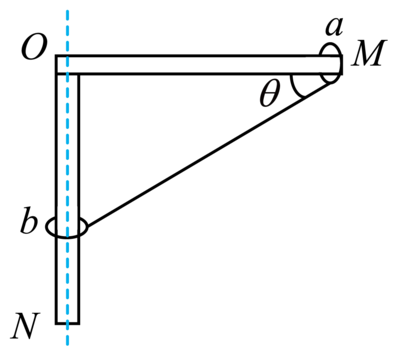

# Physics - 题目 1233

**ID**: 81ffeb8b83e741ec8a00ff4e57e2639d
**年级**: Grade 12
**难度**: Medium
**题型**: Calculation

## 题目
如图所示，“r”形框架的水平细杆OM和竖直细杆ON均光滑，质量分别为m、2m的金属环a、b用长为l的轻质细线连接，分别套在水平细杆和竖直细杆上，水平细杆离地高度为3l，a环在水平外力作用下，静止在水平杆末端M处，且 $θ=30{}\degree $ ，重力加速度为g。​​​​​​​‌（1）求线上的张力T；（2）若撤去a环上的水平拉力，让整个装置绕ON匀速转动，使细线与水平杆间夹角仍为30°，求此时装置转动的角速度 $ω$ ；（3）在第2问的情景下，突然线断开，求当a环落地时，a、b环之间的距离s（两环落地后不反弹）。

## 解答

1. （1）对b环根据平衡条件可得 $T\sin θ=2mg$ ，解得 $T=4mg$ 。
2. （2）使细线与水平杆间夹角仍为30°，说明此时线上的张力不变，对a根据牛顿第二定律有 $T{\cos}θ=mω{^{2}}l{\cos}θ$ ，解得 $ω=2\sqrt {\frac {g}{l}}$ 。
3. （3）在（2）情境下，a环的线速度大小为 $v=ωl{\cos}θ$ ，解得 $v=\sqrt {3gl}$ ，线断开后，a环沿线速度方向飞出做平抛运动，下落时间为 $3l=\frac {1}{2}gt{^{2}}$ ，解得 $t=\sqrt {\frac {6l}{g}}$ ，水平位移大小为 $x=vt$ ，解得 $x=3\sqrt {2}l$ ，当a环落地时，a、b环之间的距离为 $s=\sqrt {x{^{2}}+{\left({l{\cos}θ}\right)^{2}}}$ ，求得 $s=\frac {5\sqrt {3}}{2}l$ 。

## 知识点

**中文**:
  - 圆锥摆问题

**English**:
  - Conical Pendulum Problems

---
