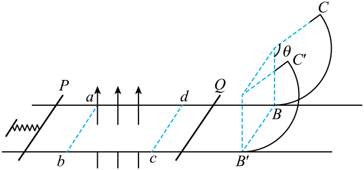

# Physics - 题目 1686

**ID**: 968824c83fb54f74a58a585eaf6af1d7
**年级**: Grade 12
**难度**: Medium
**题型**: Calculation

## 题目
如图所示，足够长的两平行光滑金属导轨固定在水平面上，导轨间距为 $L=1{\rm{m}}$ ，导轨水平部分的矩形区域abcd有竖直向上的匀强磁场，磁感应强度大小为 $B=0.5{\rm{T}}$ ，导轨水平部分的左侧固定了一轻质绝缘弹簧，右侧和一光滑圆弧轨道平滑连接，圆弧轨道半径 $r=\frac {16}{35}{\rm{m}}$ ，圆心角 $θ=120{^{\circ }}$ ，在圆弧上端有两弹性挡板C和 $C^{′}$ （碰撞时无能量损失）。​​​​​​​‌质量为 $m{{}_{1}}=1{\rm{k}}{\rm{g}}$ 、电阻 $R{{}_{1}}=0.1Ω$ 的金属棒P把轻质弹簧压缩，使弹簧的弹性势能 $E{{}_{{\rm{p}}}}=32{\rm{J}}$ ，P离开弹簧后进入磁场区域，再与磁场右侧的另一根质量为 $m{{}_{2}}=2{\rm{k}}{\rm{g}}$ 、电阻 $R{{}_{2}}=0.2Ω$ 的静置在导轨上的金属棒Q发生弹性碰撞，碰后Q恰好能上升到C和 $C^{′}$ 处。重力加速度取 $g=10{\rm{m}}{\rm{/}}{\rm{s}}{^{{\rm{2}}}}$ ，感应电流产生的磁场及导轨的电阻忽略不计，两根金属棒运动过程中始终与导轨垂直且接触良好。（1）求P刚进入磁场时电流的大小；（2）求矩形磁场沿导轨方向的长度是多少；（3）若Q从右侧圆弧滑下时，P已从磁场中滑出，求从P开始运动到PQ第二次碰撞时，P棒上产生的焦耳热。

## 解答

1. （1）根据机械能守恒 $E{{}_{{\rm{p}}}}=\frac {1}{2}m{{}_{1}}v{{}_{0}^{2}}=32{\rm{J}}$ ，解得P刚进入磁场时速度为 $v{{}_{0}}=8{\rm{m}}{\rm{/}}{\rm{s}}$ ，P刚进入磁场时，感应电动势为 $E=BLv{{}_{0}}=0.5\times 1\times 8{\rm{V}}=4{\rm{V}}$ ，P刚进入磁场时电流的大小 $I=\frac {E}{R{{}_{1}}+R{{}_{2}}}=\frac {40}{3}{\rm{A}}$
2. （2）设Q在C点的速度为 $v{{}_{C}}$ ，根据牛顿第二定律 $m{{}_{2}}g{\sin}30{^{\circ }}=m{{}_{2}}\frac {v{{}_{C}^{2}}}{r}$ ，Q从B点到C点，根据动能定理得 $\frac {1}{2}m{{}_{2}}v{{}_{C}^{2}}-\frac {1}{2}m{{}_{2}}v{{}_{B}^{2}}=-m{{}_{2}}gr(1+{\sin}30{^{\circ }})$ ，解得 $v{{}_{B}}=4{\rm{m}}{\rm{/}}{\rm{s}}$ ，P第一次通过磁场后与Q发生弹性碰撞，由动量守恒、机械能守恒得 $m{{}_{1}}v{{}_{{\rm{P}}}}=m{{}_{1}}v^{′}{{{}_{{\rm{P}}}}}+m{{}_{2}}v{{}_{B}}$ ， $\frac {1}{2}m{{}_{1}}v{{}_{{\rm{P}}}^{2}}=\frac {1}{2}m{{}_{1}}v^{′}{{{}_{{\rm{P}}}^{2}}}+\frac {1}{2}m{{}_{2}}v{{}_{B}^{2}}$ ，解得 $v{{}_{{\rm{P}}}}=6{\rm{m}}{\rm{/}}{\rm{s}}$ ， $v^{′}{{{}_{{\rm{P}}}}}=-2{\rm{m}}{\rm{/}}{\rm{s}}$ ，对于P第一次通过磁场过程，以向右为正方向，根据动量定理得 $-B{\overline{I{{}_{1}}}}L\Delta t{{}_{1}}=m{{}_{1}}v{{}_{{\rm{P}}}}-m{{}_{1}}v{{}_{0}}$ ，其中 $q{{}_{1}}={\overline{I{{}_{1}}}}\Delta t{{}_{1}}=\frac {\Delta Φ}{R{{}_{1}}+R{{}_{2}}}=\frac {BLx}{R{{}_{1}}+R{{}_{2}}}$ ，解得矩形磁场沿导轨方向的长度为 $x=2.4{\rm{m}}$
3. （3）P第二次通过磁场过程，以向左为正方向，根据动量定理得 $-B{\overline{I{{}_{2}}}}L\Delta t{{}_{2}}=m{{}_{1}}v^{′′}{{{}_{{\rm{P}}}}}-m{{}_{1}}(-v^{′}{{{}_{{\rm{P}}}}})$ ，其中 $q{{}_{2}}={\overline{I{{}_{2}}}}\Delta t{{}_{2}}=\frac {\Delta Φ}{R{{}_{1}}+R{{}_{2}}}=\frac {BLx}{R{{}_{1}}+R{{}_{2}}}$ ，解得 $v^{′′}{{{}_{{\rm{P}}}}}=0$ ，Q第一次通过磁场过程，以向左为正方向，根据动量定理得 $-B{\overline{I{{}_{3}}}}L\Delta t{{}_{3}}=m{{}_{2}}v^{′}{{{}_{{\rm{Q}}}}}-m{{}_{2}}v{{}_{B}}$ ，其中 $q{{}_{3}}={\overline{I{{}_{3}}}}\Delta t{{}_{3}}=\frac {\Delta Φ}{R{{}_{1}}+R{{}_{2}}}=\frac {BLx}{R{{}_{1}}+R{{}_{2}}}$ ，解得 $v^{′}{{{}_{{\rm{Q}}}}}=3{\rm{m}}{\rm{/}}{\rm{s}}$ ，从P开始运动到PQ第二次碰撞时，根据能量守恒有 $Q{{}_{总}}=\frac {1}{2}m{{}_{1}}v{{}_{0}^{2}}-\frac {1}{2}m{{}_{2}}v^{′}{{{}_{{\rm{Q}}}^{2}}}=23{\rm{J}}$ ，P棒上产生的焦耳热为 $Q=\frac {R{{}_{1}}}{R{{}_{1}}+R{{}_{2}}}Q{{}_{总}}=\frac {23}{3}{\rm{J}}$

## 知识点

**中文**:
  - 导体切割磁感线产生感应电动势（电流）的分析与计算
  - 电磁感应现象中的功能问题

**English**:
  - Analysis and Calculation of Cutting Magnetic Field Lines
  - Work-Energy Problems in EM Induction

---
