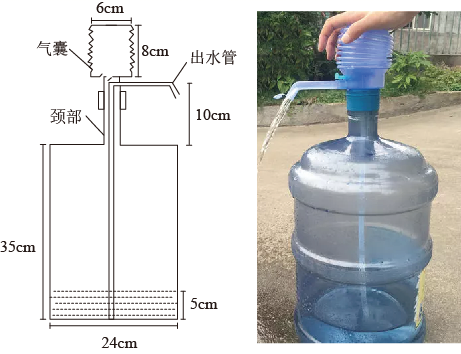

# Physics - 题目 2028

**ID**: 9bb0d56d6d93493f954032ce5e6fa4f6
**年级**: Grade 12
**难度**: Medium
**题型**: Calculation

## 题目
桶装纯净水及压水装置原理如图所示。​​​​​​​‌柱形水桶直径为 $24{\rm{c}}{\rm{m}}$ ，高为 $35{\rm{c}}{\rm{m}}$ ；柱形压水器气囊直径为 $6{\rm{c}}{\rm{m}}$ 、高为 $8{\rm{c}}{\rm{m}}$ ，水桶颈部的长度为 $10{\rm{c}}{\rm{m}}$ 。当人用力向下压气囊时，气囊中的空气被压入桶内，桶内气体的压强增大，水通过细出水管流出。已知水桶所在处的大气压强相当于 $10.00{\rm{m}}$ 水柱产生的压强，当桶内的水还剩 $5{\rm{c}}{\rm{m}}$ 高时，桶内气体的压强等于大气压强，忽略水桶颈部的体积。（i）至少需要把气囊完全压下几次，才能有水从出水管流出？（不考虑温度的变化）（ii）若桶内气体已封闭，将水桶从7℃的室外移到室内，一段时间后发现有水从管口溢出，则室内温度至少是多少℃？（不考虑水体积的膨胀）

## 解答

1. （i）解法一：
2. 水刚好流出时，桶内气压增大的数值为
3. ${\rm{Δ}}P=(30+10){\rm{c}}{\rm{m}}{\rm{H}}{{}_{2}}{\rm{O}}=40{\rm{c}}{\rm{m}}{\rm{H}}{{}_{2}}{\rm{O}}$
4. 设气囊中气体的体积为 $V{{}_{0}}$ ，n次压入水桶的气体，相当于一次压入 $nV{{}_{0}}$ 到水桶内，使桶内气压增加 $40{\rm{c}}{\rm{m}}{\rm{H}}{{}_{2}}{\rm{O}}$ ，只以压入水桶中的气体为研究对象，由玻意耳定律有
5. $P{{}_{0}}\times nV{{}_{0}}={\rm{Δ}}P\times V$
6. 代入数据解得
7. $n=2.4$ 次
8. 所以至少需要压缩3次。
9. 解法二：
10. 水刚好流出时，桶内气压增大的数值为
11. ${\rm{Δ}}P=(30+10){\rm{c}}{\rm{m}}{\rm{H}}{{}_{2}}{\rm{O}}=40{\rm{c}}{\rm{m}}{\rm{H}}{{}_{2}}{\rm{O}}$
12. 如果以n次压入的气体 $nV{{}_{0}}$ 和桶内气体V这个整体为研究对象，由玻意耳定律有
13. $P{{}_{0}}\times \left ({nV{{}_{0}}+V}\right )=\left ({P{{}_{0}}+{\rm{Δ}}P}\right )\times V$
14. 代入数据解得
15. $n=2.4$ 次
16. 所以至少需要压缩3次。
17. （ii）封闭气体的体积不变，由查理定律可得
18. $\frac {P{{}_{0}}}{T{{}_{0}}}=\frac {P{{}_{1}}}{T{{}_{1}}}$
19. 其中 $T{{}_{0}}=273+7{\rm{K}}=280{\rm{K}}$ ，代入数据解得
20. $T{{}_{1}}=291.2{\rm{K}}$
21. 则室内温度至少是18.2℃。

## 知识点

**中文**:
  - 气体的等容变化与查理定律

**English**:
  - Isochoric Change and Charles's Law

---
