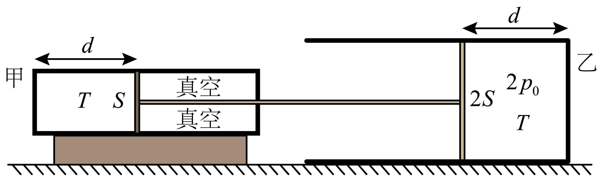

# Physics - 题目 2745

**ID**: 9cae2ce96e8445d2b81db237ce8732f8
**年级**: Grade 12
**难度**: Medium
**题型**: Calculation

## 题目
如图所示，甲、乙两汽缸水平固定放置，面积分别为S和2S的两活塞通过水平轻杆连接封闭两部分理想气体，甲汽缸的活塞外侧为真空，稳定时乙汽缸内的气体压强为 $2p{{}_{0}}$ ，两部分气体的长度均为d，温度均为T，外界大气压强为 $p{{}_{0}}$ ，活塞与汽缸壁间摩擦不计，求：（1）甲汽缸内气体的压强；（2）保持乙汽缸内气体的温度不变，缓慢升高甲汽缸内气体的温度，当杆移动 $0.2d$ 的距离时甲汽缸内气体的温度。​​​​​​​‌

## 解答

1. （1）设初始状态甲汽缸内的气体压强为 $p{{}_{1}}$ ，由平衡条件得
2. $p{{}_{1}}S+p{{}_{0}}\cdot 2S=2p{{}_{0}}\cdot 2S$
3. 解得
4. $p{{}_{1}}=2p{{}_{0}}$
5. （2）设杆移动 $0.2d$ 时两部分气体的压强分别为 $p{{}_{甲}}$ 、 $p{{}_{乙}}$ ，由平衡条件得
6. $p{{}_{甲}}S+p{{}_{0}}\cdot 2S=p{{}_{乙}}\cdot 2S$
7. 对甲部分气体有理想气体状态方程可得
8. $\frac {p{{}_{1}}dS}{T}=\frac {p{{}_{甲}}\cdot 1.2dS}{T^{′}}$
9. 乙部分气体等温变化有
10. $4p{{}_{0}}dS=1.6p{{}_{乙}}dS$
11. 解得
12. $T^{′}=1.8{\rm{T}}$

## 知识点

**中文**:
  - 利用理想状态方程解决问题

**English**:
  - Problem Solving using Ideal Gas Law

---
