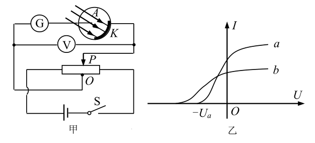

# Physics - 题目 613

**ID**: ad24a4d779a04cf7a97f15a5b0fc9166
**年级**: Grade 12
**难度**: Medium
**题型**: Calculation

## 题目
大量处于 $n=5$ 激发态的氢原子跃迁时，发出频率不同的大量光子，将这些不同频率的光分别照射到图甲电路中光电管阴极K上时，只能测得两条光电流随光电管两端电压变化的图像（如图乙）。​​​​​​​‌已知a光对应的遏止电压为 $U{{}_{{\rm{a}}}}$ ，氢原子的基态能量为 $E{{}_{1}}$ ，激发态能量为 $E{{}_{{\rm{n}}}}=\frac {E{{}_{1}}}{n{^{2}}}$ ，其中 $n=2,3,4$ ，普朗克常量为h，电子电荷量为e。（1）求光电管阴极的逸出功 $W{{}_{0}}$ 和b光对应的遏止电压 $U{{}_{{\rm{b}}}}$ ；（2）若用b光照射，光电管两端加上的电压 $U{{}_{{\rm{K}}{\rm{A}}}}=U{{}_{0}}$ ，求电子到达A极时的最大动能 $E{{}_{{\rm{k}}{\rm{m}}}}$ 。

## 解答

1. 解：（1）只能测得两条光电流随光电管两端电压变化的图像，说明只有能级差最大的两种光发生光电效应，即 $hν{{}_{{\rm{a}}}}=E{{}_{4}}-E{{}_{1}}$ ， $hν{{}_{{\rm{b}}}}=E{{}_{5}}-E{{}_{1}}{\rm \mathit{a}}$ 光照射时 $eU{{}_{{\rm{a}}}}=\left ({E{{}_{4}}-E{{}_{1}}}\right )-W{{}_{0}}$ ，解得 $W{{}_{0}}=-\frac {15}{16}E{{}_{1}}-eU{{}_{{\rm{a}}}}{\rm \mathit{b}}$ 光照射时 $eU{{}_{{\rm{b}}}}=\left ({E{{}_{5}}-E{{}_{1}}}\right )-W{{}_{0}}$ ，解得 $U{{}_{{\rm{b}}}}=\frac {E{{}_{5}}-E{{}_{4}}}{e}+U{{}_{{\rm{a}}}}=U{{}_{{\rm{a}}}}-\frac {9E{{}_{1}}}{400e}$
2. （2）由能量守恒定律有 $E{{}_{{\rm{k}}{\rm{m}}}}=eU{{}_{{\rm{b}}}}-eU{{}_{0}}$ ，解得 $E{{}_{{\rm{k}}{\rm{m}}}}=eU{{}_{{\rm{a}}}}-\frac {9E{{}_{1}}}{400}-eU{{}_{0}}$

## 知识点

**中文**:
  - 光电效应规律的综合应用

**English**:
  - Comprehensive Application of Photoelectric Effect

---
