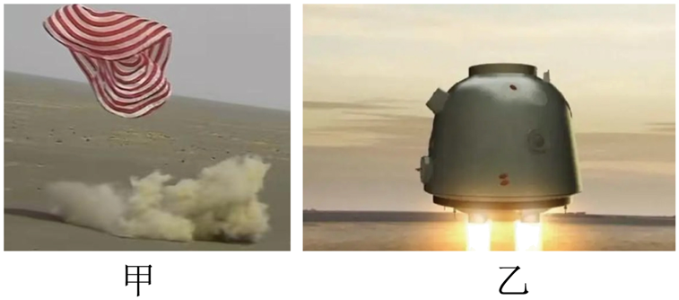

# Physics - 题目 2181

**ID**: ad58f5eb77124cb694cfefdfe532d5d5
**年级**: Grade 12
**难度**: Medium
**题型**: Calculation

## 题目
2023年6月4日6时33分，神舟十五号载人飞船返回舱在东风着陆场成功着陆。​​​​​​​‌如图甲所示，返回舱在距离地表约10km的高度打开降落伞，速度减至8m/s后保持匀速向下运动。在距离地面的高度约1m时，返回舱底部配备的4台着陆反推发动机开始点火竖直向下喷气，使返回舱的速度在0.2s内由8m/s降到2m/s。假设反推发动机工作时主伞与返回舱之间的绳索处于松弛状态，此过程返回舱的质量变化和受到的空气阻力均忽略不计。返回舱的总质量为3×10^{3}kg，g取10m/s^{2}。（1）求反推发动机工作过程中返回舱动量变化量的大小；（2）为了估算反推发动机工作过程中返回舱受到的平均推力大小，A、B两位同学给出了如下两种不同的解法。A同学的解法：设反推发动机受到的推力为F，根据动量定理FΔt=mv_{2}-mv_{1}解得$F=\frac {mv{{}_{2}}-mv{{}_{1}}}{\Delta t}$$=\left ({\frac {3000\times 2-3000\times 8}{0.2}}\right ){\rm{N}}$$=-9.0\times 10{^{4}}{\rm{N}}$B同学的解法：设反推发动机受到的推力为F，根据动量定理(F-mg)Δt=mv_{2}-mv_{1}解得$F=mg+\frac {mv{{}_{2}}-mv{{}_{1}}}{\Delta t}$$=\left ({3.0\times 10{^{4}}+\frac {3000\times 2-3000\times 8}{0.2}}\right ){\rm{N}}$$=-6.0\times 10{^{4}}{\rm{N}}$请分析判断以上两种解法是否正确。若不正确，请说明错误原因。（3）若已知反推发动机喷气过程中返回舱受到的平均推力大小为F，喷出气体的密度为ρ，4台发动机喷气口的直径均为D，喷出气体的重力忽略不讳，喷出气体的速度远大于返回舱运动的速度。求喷出气体的速度。

## 解答

1. （1）规定竖直向下为正方向，喷气过程中返回舱动量变化量为 $\Delta p=mv{{}_{2}}-mv{{}_{1}}=-1.8\times 10{^{4}}{\rm{k}}{\rm{g}}\cdot {\rm{m}}{\rm{/}}{\rm{s}}$
2. 喷气过程中返回舱动量变化量的大小为1.8×10^{4}kg·m/s；
3. （2）A、B两同学的解法均不正确，A同学忽略了重力，B同学没有规定正方向，解题过程中力的正方向与速度的正方向不一致，正确解法如下：
4. 设返回舱受到的平均推力为F，取竖直向下为正方向，根据动量定理得(mg-F)Δt=mv_{2}-mv_{1}
5. 解得 $F=1.2\times 10{^{5}}{\rm{N}}$
6. （3）以Δt时间内喷出的气体为研究对象，设喷出气体的速度为v，则每台发动机喷出气体的质量为 $m=ρ\cdot \frac {πD{^{2}}}{4}\cdot vΔt$
7. 对4台发动机喷出的气体，由动量定理可得 $F^{′}\Delta t=4mv$
8. 根据牛顿第三定律可得 $F^{′}=F$
9. 解得 $v=\sqrt {\frac {F}{\mathrm{π}ρD{^{2}}}}$

## 知识点

**中文**:
  - 动量定理及其应用

**English**:
  - Applications of Impulse-Momentum Theorem

---
