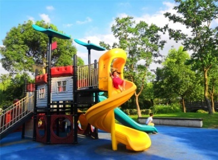

# Physics - 题目 2249

**ID**: b5f7842e64df4ce280fb5e2a446bd0f3
**年级**: Grade 12
**难度**: Medium
**题型**: Calculation

## 题目
某体育公园儿童游乐场的滑梯如图所示。​​​​​​​‌某同学拿着一质量为m的玩具汽车A（可视为质点）从滑梯上端由静止释放，A沿滑梯滑下后，从底端水平抛出并落在地面。已知滑梯上端距离地面的高度为H，底端（飞出点）距离地面的高度为h，A在滑梯上运动的总路程为s，假设在滑梯上A受到的阻力大小恒为f，重力加速度为g，不计空气阻力。（1）求A的落地点到滑梯底端的水平距离x。（2）假如在滑梯底端放置一个完全相同的玩具汽车B（可视为质点），若A、B相撞后立即粘在一起，则A、B整体的落地点到滑梯底端（飞出点）的距离为多少？（3）A沿滑梯滑下后与静止于滑梯底端的玩具汽车C（可视为质点）相撞，A、C相撞过程中无机械能损失。为使C可以飞得比（1）中的A更远，C的质量需满足什么条件？

## 解答

1. （1）A从开始运动到刚到底端抛出时有 $mg(H-h)-fs=\frac {1}{2}mv{{}_{0}}{^{2}}$ ，从底端抛出时有 $h=\frac {1}{2}gt{^{2}}$ ， $x=v{{}_{0}}t$ ，解得 $x=2\sqrt {h(H-h)}$
2. （2）A、B相撞后立即粘在一起，则由动量守恒可得 $mv{{}_{0}}=2mv{{}_{共}}$ ，A、B整体的落地点到滑梯底端（飞出点）的距离 $x{{}_{共}}=v{{}_{共}}t=\sqrt {h(H-h)}$
3. （3）A、C相撞过程由动量守恒和机械能守恒可得 $mv{{}_{0}}=mv^{′}+mv{{}_{{\rm{C}}}}$ ， $\frac {1}{2}mv{{}_{0}}{^{2}}=\frac {1}{2}mv^{′}{{^{2}}}+\frac {1}{2}mv{{}_{{\rm{C}}}}{^{2}}$ ，解得 $v^{′}=\frac {m-m{{}_{{\rm{C}}}}}{m+m{{}_{{\rm{C}}}}}v{{}_{0}}$ ， $v{{}_{{\rm{C}}}}=\frac {2m}{m+m{{}_{{\rm{C}}}}}v{{}_{0}}$ ，为使C可以飞得比（1）中的A更远，则应满足 $v{{}_{{\rm{C}}}}>v{{}_{0}}$ ，则有 $2m>m+m{{}_{{\rm{C}}}}$ ，解得 $m{{}_{{\rm{C}}}}<m$

## 知识点

**中文**:
  - 动量和能量的综合应用

**English**:
  - Integration of Momentum and Energy

---
