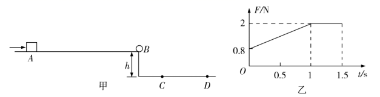

# Physics - 题目 1475

**ID**: c4ec33575eb14848a0ab6874282bfc8f
**年级**: Grade 12
**难度**: Medium
**题型**: Calculation

## 题目
如图甲所示，水平台面AB与水平地面间的高度差h=0.45m，一质量m=0.1kg的小钢球静止在台面右角B处。​​​​​​​‌一小钢块在水平向右的推力F作用下从A点由静止开始做向右直线运动，力F的大小随时间变化的规律如图乙所示，当t=1.5s时立即撤去力F，此时钢块恰好与钢球发生弹性正碰，碰后钢块和钢球水平飞离台面，分别落到地面上的C点和D点。已知B、D两点间的水平距离是B、C两点间的水平距离的3倍，钢块与台面间的动摩擦因数μ= $\frac {4}{5}$ ，取g=10m/s^{2.}求：(1)钢块的质量m_{1}；(2)B、C两点间的水平距离x_{1}。

## 解答

1. (1)设碰前钢块的速度大小为 $v$ ，碰后钢块、钢球的速度大小分别为 $v{{}_{1}}$ 、 $v{{}_{2}}$ ，碰后钢块、钢球均做平抛运动，根据水平位移关系则
2. $v{{}_{2}}=3v{{}_{1}}$
3. 钢块与钢球发生弹性正碰，动量守恒和机械能守恒，则有
4. $m{{}_{1}}v=m{{}_{1}}v{{}_{1}}+m{{}_{2}}v{{}_{2}}$
5. $\frac {1}{2}m{{}_{1}}v{^{2}}{\rm{=}}\frac {1}{2}m{{}_{1}}v{{}_{1}^{2}}{\rm{+}}\frac {1}{2}m{{}_{2}}v{{}_{2}^{2}}$
6. 解得
7. $m{{}_{1}}=0.3{\rm{k}}{\rm{g}}$
8. (2)根据 $F-t$ 图像中图线与 $t$ 轴所包围的面积表示冲量，则 $0-1.5{\rm{s}}$ 时间内推力的冲量大小为
9. $I{{}_{F}}=2\times 1.5-\frac {1}{2}\times (2-0.8)\times 1{\rm{N}}\centerdot {\rm{s}}=2.4{\rm{N}}\centerdot {\rm{s}}$
10. 根据动量定理有
11. $I{{}_{F}}-{\rm μm}{{}_{1}}gt{{}_{2}}=m{{}_{1}}v-0$
12. 解得
13. $v=4{\rm{m}}{\rm{/}}{\rm{s}}$ ， $v{{}_{1}}=2{\rm{m}}{\rm{/}}{\rm{s}}$
14. 碰后钢块做平抛运动，则有
15. $h=\frac {1}{2}gt{{}_{1}^{2}}$
16. $x{{}_{1}}=v{{}_{1}}t$
17. 解得
18. $x{{}_{1}}=0.6{\rm{m}}$

## 知识点

**中文**:
  - 动量定理及其应用
  - 子弹-木块模型

**English**:
  - Applications of Impulse-Momentum Theorem
  - Bullet-Block Model

---
