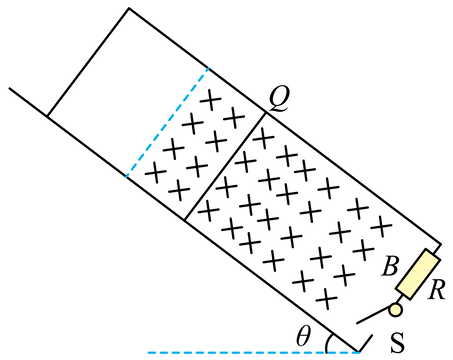

# Physics - 题目 2618

**ID**: c511629b19ea4f0fadd1469b78760dff
**年级**: Grade 12
**难度**: Medium
**题型**: Calculation

## 题目
如图所示，倾角θ=37°的斜面上有两根足够长的平行导轨，其间距d=0.5m，底端接有R=2Ω的电阻。​​​​​​​‌垂直导轨的虚线下方整个空间存在着垂直导轨平面向下的匀强磁场，磁感应强度B=2T。有两个质量均为m=200g的导体棒P、Q恰好静止在导轨上，导体棒P、Q与导轨接触良好且与导轨间的动摩擦因数均相同，长度与导轨间距相等，两导体棒的电阻均为r=1Ω，导轨的电阻不计。P在虚线上方某位置，Q在虚线下方磁场内。开关S断开，给导体棒P沿导轨向下的冲量 $I{{}_{0}}=2{\rm{N}}\cdot {\rm{s}}$ ，当两根导体棒速度相等时闭合开关S，两导体棒始终未接触，最大静摩擦力等于滑动摩擦力，取重力加速度g=10m/s^{2}，sin37°=0.6，cos37°=0.8。求：(1)导体棒与导轨之间的动摩擦因数；(2)导体棒P刚过虚线时，导体棒Q的加速度大小；(3)当两根导体棒速度相等时，流过导体棒Q的电荷量；(4)闭合开关S后，电阻R中产生的总热量。

## 解答

1. （1）导体棒P、Q恰好静止在导轨上，对导体棒受力分析可得 $mg\sin θ={\rm μm}g{\cos}θ$ ，
2. 解得 $μ={\tan}θ=0.75$ 。
3. （2）根据动量定理得 $I{{}_{0}}=mv{{}_{0}}$ ，得 $v{{}_{0}}=10{\rm{m}}/{\rm{s}}$ ，
4. 导体棒P刚过虚线时切割磁感线产生感应电动势 $E=Bdv{{}_{0}}$ ，代入数据得 $E=10{\rm{V}}$ ，
5. 导体棒P、Q中的电流 $I=\frac {E}{2r}$ ，代入数据得 $I=5{\rm{A}}$ ，
6. 对导体棒Q根据牛顿第二定律得 $mg\sin θ-{\rm μm}g{\cos}θ+BId=ma$ ，
7. 代入数据得 $a=25{\rm{m}}/{\rm{s}}{^{2}}$ 。
8. （3）开关S断开时，导体棒P、Q满足动量守恒， $mv{{}_{0}}=(m+m)v{{}_{1}}$ ，
9. 代入数据得 $v{{}_{1}}=5{\rm{m}}/{\rm{s}}$ ，
10. 设流过导体棒Q的平均电流为 ${\overline{I}}$ ，根据动量定理得 $B{\overline{I}}d\cdot t=mv{{}_{1}}-0$ ，
11. 电量 $q=\bar It$ ，
12. 联立得 $q=\frac {mv{{}_{1}}}{Bd}$ ，
13. 代入数据得 $q=1{\rm{C}}$ 。
14. （4）闭合开关S后，由于 $mg\sin θ={\rm μm}g{\cos}θ$ ，得重力势能减少量等于摩擦生热
15. 则导体棒P、Q动能减少量等于系统产生的焦耳热， $Q{{}_{总}}=\frac {1}{2}(m+m)v{{}_{1}^{2}}$ ，
16. 代入数据得 $Q{{}_{总}}=5{\rm{J}}$ ，
17. 闭合开关S导体棒P、Q中电流相等，电阻R中的电流等于导体棒P、Q中电流之和，电阻 $R=2Ω$ ，两根导体棒的电阻均为 $r=1Ω$ ，设导体棒P、Q和电阻R的热功率分别为P_{P}、P_{Q}、P_{R}。
18. 根据热功率 $P{{}_{热}}=I{^{2}}R$ 得 $P{{}_{{\rm{R}}}}=8P{{}_{{\rm{P}}}}=8P{{}_{{\rm{Q}}}}$ ，产生的热量 $Q{{}_{{\rm{R}}}}=8Q{{}_{{\rm{P}}}}=8Q{{}_{{\rm{Q}}}}$ ，
19. 则 $Q{{}_{总}}=Q{{}_{{\rm{R}}}}+Q{{}_{{\rm{P}}}}+Q{{}_{{\rm{Q}}}}$ ，
20. 解得 $Q{{}_{{\rm{R}}}}=4{\rm{J}}$ 。

## 知识点

**中文**:
  - 导体切割磁感线产生感应电动势（电流）的分析与计算
  - 电磁感应现象中的功能问题

**English**:
  - Analysis and Calculation of Cutting Magnetic Field Lines
  - Work-Energy Problems in EM Induction

---
