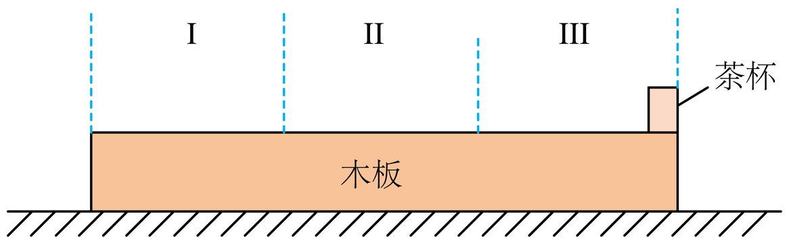

# Physics - 题目 2364

**ID**: c954d225bfef433cb7587487cf58c79d
**年级**: Grade 12
**难度**: Medium
**题型**: Calculation

## 题目
学校举行教职工趣味运动会，其中一项娱乐项目的情景如图所示，放置在水平面上的长度为L=1.5m的木板等分为三个区域Ⅰ、Ⅱ、Ⅲ，茶杯（可视为质点）置于木板的最右端，参赛者水平击打一下木板的左端，木板获得一初速度v₀后向右运动，从而带动茶杯也向右运动，最终若茶杯分别停在Ⅰ、Ⅱ、Ⅲ区域，将分别获得一、二、三等奖，已知茶杯的质量m=0.2kg，木板的质量M=1.8kg，茶杯与木板间的动摩擦因数 $μ{{}_{1}}=0.4，$ ，木板与水平面间的动摩擦因数 $μ{{}_{2}}=0.23，$ ，重力加速度g取 $10{\rm{m}}/{\rm{s}}{^{2}}。​​​​​​​‌$（1）茶杯相对木板滑动的过程中，求茶杯和木板的加速度a_{1}和a_{2}的大小。（2）若要获得一等奖，木板初速度v₀的最小值（结果可保留根号）。

## 解答

1. （1）对茶杯，根据牛顿第二定理可得 $μ{{}_{1}}mg=ma{{}_{1}}$
2. 解得 $a{{}_{1}}=4{\rm{m}}/{\rm{s}}{^{{{2}}}}$
3. 对木板有 $μ{{}_{1}}mg+μ{{}_{2}}\left ({m+M}\right )g=Ma{{}_{2}}$
4. 解得 $a{{}_{2}}=3{\rm{m}}/{\rm{s}}{^{{{2}}}}$
5. （2）当茶杯恰好滑动至Ⅰ区域的右边界时与木板共速，此后两者一起减速至零，此时木板获得初速度最小，设经过时间 $t$ 达到共速，则有 $a{{}_{1}}t=v{{}_{0}}-a{{}_{2}}t$ ， $\frac {2}{3}L=\frac {1}{2}\left ({v{{}_{0}}+v{{}_{共}}}\right )t-\frac {1}{2}v{{}_{共}}t$ ， $v{{}_{共}}=a{{}_{1}}t$
6. 解得 $v{{}_{0}}=\sqrt {14}{\rm{m}}/{\rm{s}}$

## 知识点

**中文**:
  - 板块模型

**English**:
  - Plate Model

---
