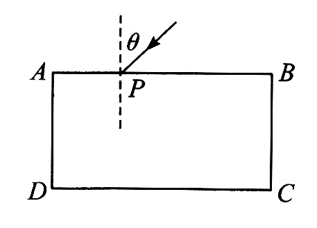

# Physics - 题目 1835

**ID**: ccd902ad123245aaa03740751407e944
**年级**: Grade 12
**难度**: Medium
**题型**: Calculation

## 题目
如图所示，矩形ABCD为一折射率为n的透明介质的截面，一束单色光以θ角入射到P点，已知AP= $\frac {1}{2}$ AD；​​​​​​​‌（i）若要使光入射后能射到AD面上， $θ$ 角的最小值为多少？（ii）要使光在AD面上都发生全反射，θ角的取值范围如何？n的取值范围如何？

## 解答

1. （i）设折射角为r时，光线恰经过D点，光路如图（a）所示。由几何关系
2. 
3. ${\sin}r=\frac {\sqrt {5}}{5}$   ①
4. 由折射定律
5. $n=\frac {{\sin}θ}{{\sin}r}$   ②
6. 解得
7. $θ={\arcsin}\frac {\sqrt {5}}{5}n$   ③
8. （ii）光线恰好在AD面上发生全反射，由折射定律
9. 
10. $n=\frac {{\sin}90{}^\circ }{{\sin}i}$   ④
11. 解得
12. ${\sin}θ=\sqrt {n{^{2}}-1}$     ⑤
13. 显然
14. $θ\leqslant {\arcsin}\sqrt {n{^{2}}-1}$ ，且 $θ\geqslant {\arcsin}\frac {\sqrt {5}}{5}n$   ⑥
15. a.若 $\frac {\sqrt {5}}{2}\leqslant n<\sqrt {2}$ ，可得
16. ${\arcsin}\frac {\sqrt {5}}{5}n\leqslant θ\leqslant {\arcsin}\sqrt {n{^{2}}-1}$   ⑦
17. b.若 $\sqrt {2}\leqslant n<\sqrt {5}$ ，可得
18. ${\arcsin}\frac {\sqrt {5}}{5}n\leqslant θ\leqslant \frac {π}{2}$    ⑧
19. c.若 $n<\frac {\sqrt {5}}{2}$ 或 $n>\sqrt {5}$ ，θ无解

## 知识点

**中文**:
  - 光的折射定律及其应用

**English**:
  - Law of Refraction and Applications

---
