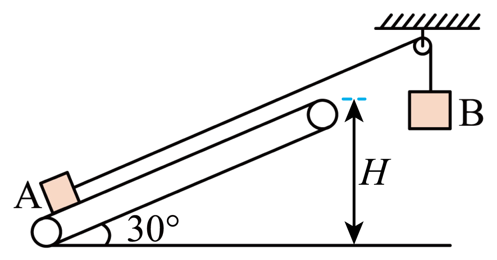

# Physics - 题目 770

**ID**: ce0de74f1964492984da25d82848a4c8
**年级**: Grade 12
**难度**: Medium
**题型**: Calculation

## 题目
如图所示，某工厂利用质量为m_{B}=300kg的物体B通过轻质绳及光滑定滑轮协助传送带传送货物，现将质量为m_{A}=200kg的物体A（可视为质点）从传送带底端（与地面等高）由静止释放，最终传送到距离地面高H处（此时物体A刚好匀速），已知传送带倾角为θ=30°，与货物接触面间的动摩擦因数为 $μ=\frac {\sqrt {3}}{3}$ ，传送带以v_{1}=6m/s的速度顺时针转动，物体A释放时，物体B最初距离地面h_{B}=6.5m且落地后不反弹，重力加速度g取10m/s^{2}。​​​​​​​‌求：(1)释放后瞬间物体A的加速度大小；(2)高度H。

## 解答

1. （1）释放A的瞬间，由于物体A的速度小于传送带速度，物体A受到传送带向上的滑动摩擦力作用，对A、B，根据牛顿第二定律可得 $F{{}_{{\rm{T}}}}+{\rm μm}{{}_{{\rm{A}}}}g{\cos}30{}\degree -m{{}_{{\rm{A}}}}g\sin 30{}\degree =m{{}_{{\rm{A}}}}a{{}_{1}}$ ， $m{{}_{{\rm{B}}}}g-F{{}_{{\rm{T}}}}=m{{}_{{\rm{B}}}}a{{}_{1}}$ ，联立可得 $a{{}_{1}}=6{\rm{m}}{\rm{/}}{\rm{s}}{^{{{2}}}}$
2. （2）物体B从静止加速至6m/s发生的位移为 $x{{}_{1}}=\frac {v{{}_{1}^{2}}}{2a{{}_{1}}}=3{\rm{m}}<{{6}}{{.}}{{5}}{\rm{m}}$ ，由于 $m{{}_{{\rm{B}}}}g=3000{\rm{N}}>m{{}_{{\rm{A}}}}g\sin 30{}\degree +{\rm μm}{{}_{{\rm{A}}}}g{\cos}30{}\degree =2000{\rm{N}}$ ，说明物体A与传送带共速后，A继续向上匀加速，A受到沿传送带向下的滑动摩擦力，根据牛顿第二定律有 $F^{′}{{{}_{{\rm{T}}}}}-{\rm μm}{{}_{{\rm{A}}}}g{\cos}30{}\degree -m{{}_{{\rm{A}}}}g\sin 30{}\degree =m{{}_{{\rm{A}}}}a{{}_{2}}$ ， $m{{}_{{\rm{B}}}}g-F^{′}{{{}_{{\rm{T}}}}}=m{{}_{{\rm{B}}}}a{{}_{2}}$ ，联立解得 $a{{}_{2}}=2{\rm{m}}{\rm{/}}{\rm{s}}{^{{{2}}}}$ ，从物体A与传送带共速到物体B落地过程，设物体落地速度大小为v_{2}，则 $v{{}_{2}^{2}}-v{{}_{1}^{2}}=2a{{}_{2}}x{{}_{2}}$ ， $x{{}_{2}}=h{{}_{{\rm{B}}}}-x{{}_{1}}$ ，解得 $v{{}_{2}}=5\sqrt {2}{\rm{m}}{\rm{/}}{\rm{s}}$ ，物体B落地后，物体A向上做匀减速直线运动至与传送带再次共速的过程，有 $m{{}_{{\rm{A}}}}g\sin 30{}\degree +{\rm μm}{{}_{{\rm{A}}}}g{\cos}30{}\degree =m{{}_{{\rm{A}}}}a{{}_{3}}$ ， $x{{}_{3}}=\frac {v{{}_{2}^{2}}-v{{}_{1}^{2}}}{2a{{}_{3}}}$ ，联立解得 $x{{}_{3}}=0.7{\rm{m}}$ ，由于 $μ={\tan}30{}\degree $ ，所以，当物体A与传送带共速后，将做匀速运动，所以 $H=(x{{}_{1}}+x{{}_{2}}+x{{}_{3}})\sin 30{}\degree =3.6{\rm{m}}$

## 知识点

**中文**:
  - 连接体问题（整体和隔离法）、临界问题

**English**:
  - Connected Bodies Problems (Whole/Isolation Method), Critical Problems

---
