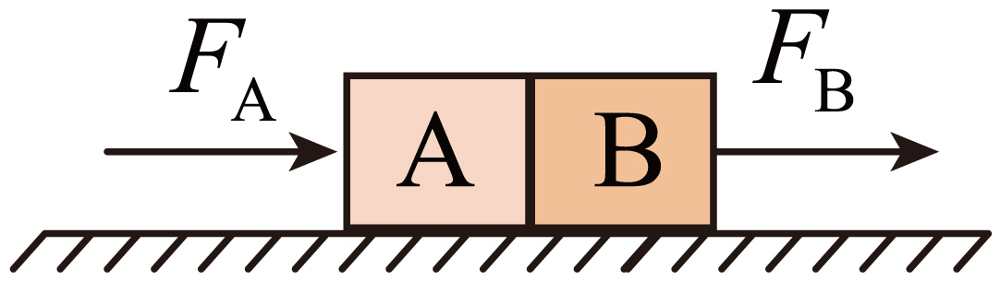

# Physics - 题目 832

**ID**: d47720c7ec204aaf9a5abd2e76170bfd
**年级**: Grade 12
**难度**: Medium
**题型**: Calculation

## 题目
如图所示，A、B两个物体相互接触但并不黏合，放置在水平面上，水平面与物体间的摩擦力可忽略，两物体的质量为 $m{{}_{{\rm{A}}}}=4\{\rm{k}}{\rm{g}}$ ， $m{{}_{{\rm{B}}}}=6\{\rm{k}}{\rm{g}}$ 。​​​​​​​‌从 $t=0$ 开始，推力 $F{{}_{{\rm{A}}}}$ 和拉力 $F{{}_{{\rm{B}}}}$ 分别作用于A、B上， $F{{}_{{\rm{A}}}}$ 和 $F{{}_{{\rm{B}}}}$ 随时间变化的规律为$F{{}_{{\rm{A}}}}=\left ({8-2t}\right )\left ({{\rm{N}}}\right )$$F{{}_{{\rm{B}}}}=\left ({2+2t}\right )\left ({{\rm{N}}}\right )$通过计算做出物体B的加速度随时间变化的图线（在给定的虚线框内画图）。

## 解答

1. $t=0$ 时，对整体由牛顿第二定律
2. $F{{}_{{\rm{A}}}}+F{{}_{{\rm{B}}}}=\left ({m{{}_{{\rm{A}}}}+m{{}_{{\rm{B}}}}}\right )a{{}_{1}}$
3. 解得
4. $a{{}_{1}}=1{\rm{m}}{\rm{/}}{\rm{s}}{{}^{2}}$
5. 恰好分离时
6. $F{{}_{{\rm{B}}}}=m{{}_{{\rm{B}}}}a{{}_{1}}$
7. 解得
8. $t=2{\rm{s}}$
9. 2s后，B的加速度为
10. $F{{}_{{\rm{B}}}}=m{{}_{{\rm{B}}}}a{{}_{2}}$
11. 解得
12. $a{{}_{2}}=\frac {1+t}{3}{\rm{m}}{\rm{/}}{\rm{s}}{{}^{2}}$
13. 逐渐增大；
14. 综上所述，0～2s内， $a{{}_{1}}=1{\rm{m}}{\rm{/}}{\rm{s}}{{}^{2}}$ ，2s后， $a{{}_{2}}=\frac {1+t}{3}{\rm{m}}{\rm{/}}{\rm{s}}{{}^{2}}$ ，物体B的加速度随时间变化的图线如图
15. 

## 知识点

**中文**:
  - 连接体问题（整体和隔离法）、临界问题

**English**:
  - Connected Bodies Problems (Whole/Isolation Method), Critical Problems

---
