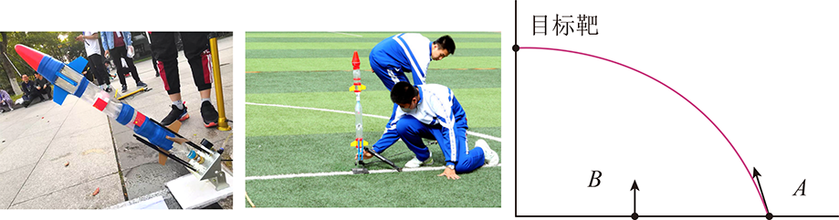

# Physics - 题目 2085

**ID**: d7d00befc19b4849ba0e3a2f7ee93b5a
**年级**: Grade 12
**难度**: Medium
**题型**: Calculation

## 题目
太原新希望双语学校高中部举办了“水火箭比赛”，同学们积极参与，展示了功能各异的水火箭。​​​​​​​‌某组同学的水火箭可以实现“定点打靶”。将目标置于3.2m高的竖直墙面上，水火箭装置置于水平地面上A点，发射位置到墙体的水平距离x＝12m，调整发射角度θ（θ为初速度与水平方向夹角），当初速度为 $v{{}_{0}}$ 时，水火箭恰好垂直墙体击中目标。不计空气阻力，取重力加速度大小 $g=10{\rm{m}}{\rm{/}}{\rm{s}}{^{2}}$ ，水火箭与目标均可视为质点。(1)求水火箭发射的初速度 $v{{}_{0}}$ ；(2)若在水火箭前进方向的水平地面上B点放置一枚“拦截型”水火箭，其发射方向竖直向上，A点与B点距离为6m。发射水火箭的同时也发射拦截火箭，要使拦截火箭拦截成功，则“拦截型”水火箭的发射速度v是多少。

## 解答

1. （1）初速度为 $v{{}_{0}}$ 的水火箭做斜上抛运动恰好垂直墙体击中目标，由逆向思维法可等效为平抛运动，有 $x=v{{}_{1}}t$ ， $h=\frac {1}{2}gt{^{2}}$ ， $v{{}_{0}}=\sqrt {v{{}_{1}^{2}}+(gt){^{2}}}$ ，联立解得 $t=0.8{\rm{s}}$ ，  $v{{}_{1}}=15{\rm{m}}{\rm{/}}{\rm{s}}$ ， $v{{}_{0}}=17{\rm{m}}{\rm{/}}{\rm{s}}$
2. （2）水火箭做等效的平抛运动到A的竖直速度为 $v{{}_{Ay}}=gt=8{\rm{m}}{\rm{/}}{\rm{s}}$ ，则水火箭做斜上抛运动的竖直分速度为 $8{\rm{m}}{\rm{/}}{\rm{s}}$ ，拦截火箭做竖直上抛运动，两者同时发射要使拦截火箭拦截成功，则竖直方向的运动完全相同，有 $v=v{{}_{Ay}}=8{\rm{m}}{\rm{/}}{\rm{s}}$

## 知识点

**中文**:
  - 斜抛运动

**English**:
  - Oblique Projectile Motion

---
