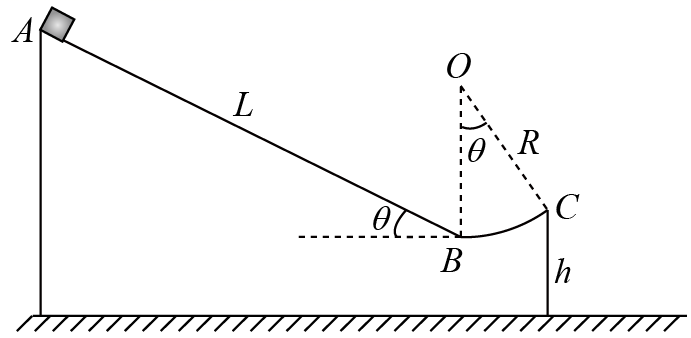

# Physics - 题目 2708

**ID**: dad5a5db1350484aaaa5fbe4bc1eea81
**年级**: Grade 12
**难度**: Medium
**题型**: Calculation

## 题目
如图所示，在竖直平面內有一粗糙斜面轨道AB与光滑圆弧轨道BC在B点平滑连接(滑块经过B点时速度大小不变)，斜面轨道长L=2.​​​​​​​‌5m，斜面倾角θ=37°，O点是圆弧轨道圆心，OB竖直，圆弧轨道半径R=1m，圆心角θ=37°，C点距水平地面的高度h=0.512m，整个轨道是固定的．一质量m=1kg的滑块在A点由静止释放，最终落到水平地面上．滑块可视为质点，滑块与斜而轨道之间的动摩擦因数μ=0.25，取g=10m/s^{2}，sin37°=0.6，cos37°=0.8不计空气阻力，求：(1)滑块经过圆弧轨道最低点B时，对圆弧轨道的压力；(2)渭块离开C点后在空中运动的时间t．

## 解答

1. （1）对滑块在A到B的过程，由动能定理
2. $mgL{\sin}37{}^\circ -{\rm μm}gL{\cos}37{}^\circ =\frac {1}{2}mv{{}_{B}^{2}}$
3. 解得
4. $v{{}_{B}}=2\sqrt {5}{{\rm{m}}}/{{\rm{s}}}$
5. 对滑块经过B点时，由牛顿第二定律
6. $F-mg=m\frac {v{{}_{B}^{2}}}{R}$
7. 由牛顿第三定律可得
8. $F=F\prime $
9. 解得
10. $F\prime =30{\rm{N}}$
11. 方向竖直向下。
12. （2）对滑块在B到C的过程，由动能定理
13. $-mgR\left ({1-{\cos}37{}^\circ }\right )=\frac {1}{2}mv{{}_{C}^{2}}-\frac {1}{2}mv{{}_{B}^{2}}$
14. 解得
15. $v{{}_{C}}=4{{\rm{m}}}/{{\rm{s}}}$
16. 滑块离开C点后在竖直方向上做竖直上抛运动，以竖直向下为正方向，则
17. $h=-v{{}_{C}}{\sin}37{}^\circ t+\frac {1}{2}gt{^{2}}{\rm{=}}0$
18. 解得
19. t=0.64s

## 知识点

**中文**:
  - 应用动能定理求解多阶段、多过程问题

**English**:
  - Multi-stage/Multi-process Problems

---
