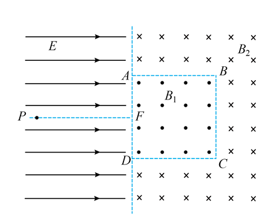

# Physics - 题目 1549

**ID**: eb320ed0d5ed449889d6d830b961f706
**年级**: Grade 12
**难度**: Medium
**题型**: Calculation

## 题目
如图所示，直线AD左侧有垂直AD的匀强电场，场强大小E=1×10^{2}N/C；直线AD右侧正方形ABCD内有垂直纸面向外的匀强磁场，磁感应强度大小B_{1}=2T；直线AD右侧正方形ABCD以外有垂直纸面向里的匀强磁场，磁感应强度大小B_{2}=B_{1}=2T。​​​​​​​‌在P点静止释放一带正电不计重力的粒子，从AD的中点F进入磁场B_{1}。已知正方形ABCD的边长L=1m，P点到直线AD的距离PF=L=1m，粒子电荷量q=2×10^{-3}C，质量m=1×10^{-5}kg。求：(1)粒子第一次进入磁场时做圆周运动的半径；(2)粒子从静止释放到速度再次为零的时间。

## 解答

1. （1）粒子从P点静止释放，不计粒子重力，从P到F根据动能定理得 $qEL=\frac {1}{2}mv{{}_{0}^{2}}$ ，
2. 代入数据得 $v{{}_{0}}=2\times 10{^{2}}{\rm{m}}{\rm{/}}{\rm{s}}$ ，
3. 设粒子在匀强磁场中的半径为R，根据洛伦兹力提供向心力得 $qv{{}_{0}}B{{}_{1}}=m\frac {v{{}_{0}^{2}}}{R}$ ，
4. 代入数据得 $R=0.5{\rm{m}}$ 。
5. （2）粒子在电场中的加速度 $a=\frac {qE}{m}=2\times 10{^{4}}{\rm{m}}{\rm{/}}{\rm{s}}{^{{{2}}}}$ ，
6. 粒子从P到F的时间是 $t{{}_{1}}=\frac {v{{}_{0}}}{a}=1\times 10{^{-2}}{\rm{s}}$ ，
7. 由于 $B{{}_{1}}=B{{}_{2}}$ ，
8. 粒子在两个磁场中做匀速圆周运动的半径都等于R，粒子在两个磁场中做匀速圆周运动的周期 $T=\frac {2πm}{qB}$ ，
9. 代入数据得 $T=\frac {π}{2}\times 10{^{-2}}{\rm{s}}$ ，
10. 根据半径 $R=\frac {L}{2}$ ，作出粒子在磁场中的运动轨迹如图所示
11. 
12. 粒子在磁场中运动的时间 $t{{}_{2}}=\frac {1}{4}T+\frac {3}{4}T+\frac {1}{4}T+\frac {1}{4}T=\frac {3π}{4}\times 10{^{-2}}{\rm{s}}$ ，
13. 粒子从静止释放到速度再次为零的时间 $t=2t{{}_{1}}+t{{}_{2}}=\frac {3π+8}{4}\times 10{^{-2}}{\rm{s}}$ 。

## 知识点

**中文**:
  - 带电粒子在组合场中的运动

**English**:
  - Motion in Combined Fields

---
