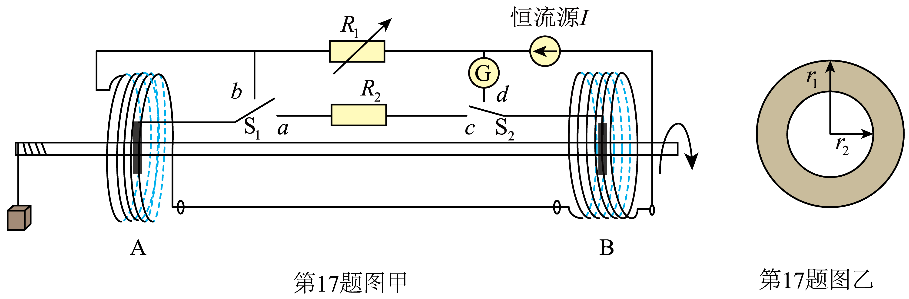

# Physics - 题目 321

**ID**: fb8693e9a4204e3c8e4cef36516d4172
**年级**: Grade 12
**难度**: Medium
**题型**: Calculation

## 题目
十九世纪中叶，科学家对物理学电学量的研究有广泛兴趣。​​​​​​​‌图甲改编自当年Rayleigh与Sidgwick设计的实验装置。其中恒流源提供大小为 $I=10{\rm{A}}$ 的电流，方向如图箭头所示。图甲中 $R{{}_{1}}$ 为可变电阻， $R{{}_{2}}$ 为阻值 $0.25Ω$ 的定值电阻， ${\rm{S}}{{}_{1}}$ 、 ${\rm{S}}{{}_{2}}$ 为单刀双掷开关。两个相同的线圈 ${\rm{A}}$ 、B，匝数均为 $N=5\times 10{^{4}}$ 匝，半径均为 $k=0.5{\rm{m}}$ 。其中心处各有一电阻不计且上端带电刷的中心镂空导体圆盘，两者相距 $l=5{\rm{m}}$ ，圆盘大圆半径 $r{{}_{1}}=0.3{\rm{m}}$ ，小圆半径 $r{{}_{2}}=0.1{\rm{m}}$ ，如图乙所示。圆盘套在一根薄壁轻质中空的金属转轴上并和它固定，转轴薄壁厚度 $d=1{\rm{m}}{\rm{m}}$ ，电阻率 $ρ=π\times 10{^{-5}}Ω\cdot {\rm{m}}$ 。一足够长且不计粗细的轻绳一端缠绕在转轴上，另一端连接一质量 $M=0.05{\rm{k}}{\rm{g}}$ 的重物。已知一匝电流为 $I$ 的线圈在中心处产生的磁感应强度大小为 $\frac {μ{{}_{0}}I}{2k}$ （其中 $μ{{}_{0}}=4π\times 10{^{-7}}{\rm{N}}/{\rm{A}}{^{2}}$ 为真空磁导率， $k$ 为线圈半径），圆盘处可看作匀强磁场。实验开始时装置开关 ${\rm{S}}{{}_{1}}$ 与 ${\rm{S}}{{}_{2}}$ 分别置于 $a$ 、 $c$ 。由静止释放重物，从左往右看转轴为顺时针转动。假设装置中A、B线圈产生的磁场互不干扰，不计一切阻力，计算时将 $π{^{2}}\approx 10$ 。(1)比较 $a$ 点和 $c$ 点的电势高低；(2)计算重物最终运动状态时圆盘的角速度的大小；(3)重新开始实验时，将 ${\rm{S}}{{}_{1}}$ 与 ${\rm{S}}{{}_{2}}$ 分别置于 $b$ 、 $d$ ，发现当物块速度 $v=6{\rm{m}}/{\rm{s}}$ 时灵敏电流计 ${\rm{G}}$ 表的示数为0。求此时可变电阻 $R{{}_{1}}$ 大小。

## 解答

1. （1）如图恒流源方向向左，由右手螺旋定则可知，与之相连的线圈A，左侧为N极，与之相连的线圈B，右侧为N极，对线圈B中的圆盘分析，线圈B内部磁感线方向水平向右，由右手定则可知，电流在 $R{{}_{2}}$ 支路中，方向由c到a，c点电势高。
2. （2）中心处磁场 $B=N\frac {μ{{}_{0}}I}{2k}=0.2π\left ({{\rm{T}}}\right )$ ，
3. 薄壁金属转轴的电阻为 $R{{}_{轴}}=ρ\frac {l}{S}=ρ\frac {l}{2πr{{}_{2}}d}=0.25{\rm{Ω}}$ ，
4. 设圆盘转动角速度为 $ω$ ，圆盘切割磁场产生的总电动势为 $E=2\times \frac {1}{2}Bω\left ({r{{}_{1}^{2}}-r{{}_{2}^{2}}}\right )$ ，
5. 由能量守恒 $Mgωr{{}_{2}}=\frac {E{^{2}}}{R{{}_{2}}+R{{}_{轴}}}$ ，
6. 可得 $ω=\frac {625}{64}{\rm{r}}{\rm{a}}{\rm{d}}/{\rm{s}}\approx 9.77{\rm{r}}{\rm{a}}{\rm{d}}/{\rm{s}}$ 。
7. （3）设可变电阻阻值为 $R{{}_{1}}$ ，此时 $E=IR{{}_{1}}$ ，
8. 根据 $E=2\times \frac {1}{2}Bω\left ({r{{}_{1}^{2}}-r{{}_{2}^{2}}}\right )$ 可得 $ω=\frac {IR{{}_{1}}}{B\left ({r{{}_{1}^{2}}-r{{}_{2}^{2}}}\right )}$ ，
9. 又由 $ω=\frac {v}{r{{}_{2}}}$ ，
10. 联立上式 $R{{}_{1}}=9.6π\times 10{^{-2}}{\rm{Ω}}$ 。

## 知识点

**中文**:
  - 导体切割磁感线产生感应电动势（电流）的分析与计算

**English**:
  - Analysis and Calculation of Cutting Magnetic Field Lines

---
