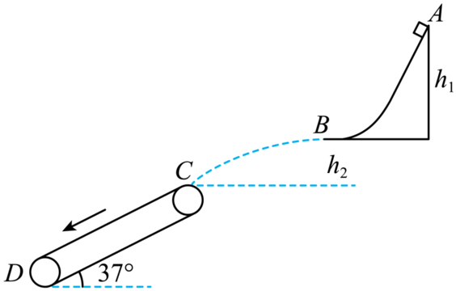

# Physics - 题目 1322

**ID**: ff7ad3ac6b6240b489bee1ac8c517ff2
**年级**: Grade 12
**难度**: Medium
**题型**: Calculation

## 题目
如图所示，固定的粗糙弧形轨道下端B点水平，上端A与B点的高度差为h_{1}＝0.3m，倾斜传送带与水平方向的夹角为θ＝37°，传送带的上端C点到B点的高度差为h_{2}＝0.1125m（传送带传动轮的大小可忽略不计）。​​​​​​​‌一质量为m＝1kg的滑块（可看作质点）从轨道的A点由静止滑下，然后从B点抛出，恰好以平行于传送带的速度从C点落到传送带上，传送带逆时针传动，速度大小为v＝0.5m/s，滑块与传送带间的动摩擦因数为μ＝0.8，且传送带足够长，滑块运动过程中空气阻力忽略不计，g＝10 m/s^{2}，试求：（1）滑块运动至C点时的速度vC大小；（2）滑块由A到B运动过程中克服摩擦力做的功W_{f}；（3）滑块在传送带上运动时与传送带摩擦产生的热量Q。

## 解答

1. （1）在C点，竖直分速度
2. $v{{}_{y}}=\sqrt {2gh{{}_{2}}}=1.5{\rm{m}}{\rm{/}}{\rm{s}}$
3. 滑块运动至C点时的速度v_{C}
4. $v{{}_{C}}=\frac {v{{}_{y}}}{\sin 37{}\degree }=2.5{\rm{m}}{\rm{/}}{\rm{s}}$
5. （2）C点的水平分速度与B点的速度相等，则
6. $v{{}_{B}}=v{{}_{x}}=v{{}_{C}}{\cos}37{}\degree =2{\rm{m}}{\rm{/}}{\rm{s}}$
7. 从A到B点的过程中，据动能定理得
8. $mgh{{}_{1}}-W{{}_{{\rm{f}}}}=\frac {1}{2}mv{{}_{B}^{2}}$
9. 解得
10. $W{{}_{f}}=1{\rm{J}}$
11. （3）滑块在传送带上运动时，根据牛顿第二定律得
12. ${\rm μm}g{\cos}37{}\degree -mg\sin 37{}\degree =ma$
13. 解得
14. $a=0.4{\rm{m}}{\rm{/}}{\rm{s}}{^{2}}$
15. 达到共同速度所需时间
16. $t=\frac {v{{}_{C}}-v}{a}=5{\rm{s}}$
17. 二者间的相对位移
18. $Δx=\frac {v+v{{}_{C}}}{2}t-vt=5{\rm{m}}$
19. 由于 $mg\sin 37{}\degree <{\rm μm}g{\cos}37{}\degree $ ，此后滑块将做匀速运动，滑块在传送带上运动时与传送带摩擦产生的热量
20. $Q={\rm μm}g{\cos}37{}\degree \cdot Δx=32{\rm{J}}$

## 知识点

**中文**:
  - 应用动能定理求解多阶段、多过程问题

**English**:
  - Multi-stage/Multi-process Problems

---
