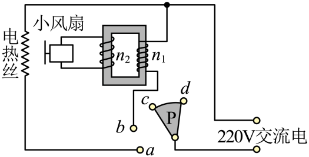
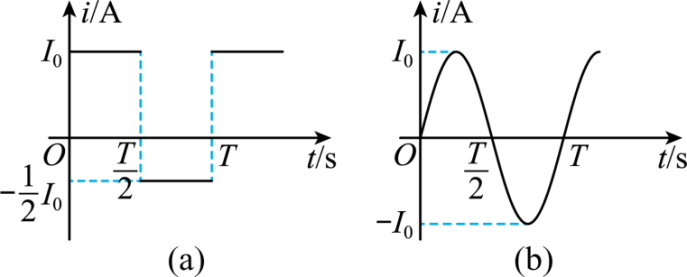

# Physics - 题目 619

**ID**: 141a8d6c954a4b96a8e8aef696a111b6
**年级**: Grade 12
**难度**: Medium
**题型**: Comprehensive

## 题目
加热物体电热器、微波炉、电磁炉都可用来加热物体，但原理各不相同。​​​​​​​‌1．如图所示为某科创小组设计的电吹风电路图，a、b、c、d为四个固定触点。可动的扇形金属触片P可同时接触两个触点。触片P处于不同位置时，电吹风可处于停机、吹热风和吹冷风三种工作状态。n_{1}和n_{2}分别是理想变压器原、副线圈的匝数。该电吹风的各项参数如表格所示。热风时输入功率460W冷风时输入功率60W小风扇额定电压60V正常工作时小风扇输出功率52W（1）吹冷风时触片P与两点相接触，吹热风时触片P与接触。

## 解答

1. 1．[1]根据电吹风原理图可知，当触片P与bc相连时，只有小风扇接入电路，电风扇吹冷风，选B；
2. [2]当触片P与ab相连时，小风扇和电热丝都接入电路，电风扇吹热风，选A。
3. [3]根据理想变压器原副线圈与匝数的关系可得 $\frac {n{{}_{1}}}{n{{}_{2}}}=\frac {U{{}_{1}}}{U{{}_{2}}}=\frac {220}{60}=\frac {11}{3}$
4. [4]小风扇吹冷风时输入功率60W，小风扇额定电压为60V，正常工作时小风扇输出功率为52W，所以 $P{{}_{热}}=P{{}_{入}}-P{{}_{出}}=8{\rm{W}}$ ， $P{{}_{热}}=I{^{2}}R$ ， $P{{}_{入}}=UI$ ，联立解得 $R=8.0Ω$ ，当小风扇吹热风时输入功率为460W，则电热丝消耗的功率为 $P=P^{′}{{{}_{入}}}-P{{}_{入}}=400{\rm{W}}$ ， $P=I{{}_{{\rm{Q}}}}U{{}_{1}}$ ，解得 $I{{}_{{\rm{Q}}}}=1.8{\rm{A}}$
5. 2．[1]电流随时间变化的方程为 $I=I{{}_{0}}{\sin}ωt=I{{}_{0}}{\sin}\frac {2π}{T}t$
6. [2]设方波交变电流的有效值为I_{1}，则 $I{{}_{1}^{2}}RT=I{{}_{0}^{2}}R\frac {T}{2}+(\frac {I{{}_{0}}}{2}){^{2}}R\frac {T}{2}$ ，电热器两次通电的电功率之比为 $\frac {P{{}_{{\rm{A}}}}}{P{{}_{{\rm{B}}}}}=\frac {I{{}_{1}^{2}}}{I{{}_{2}^{2}}}=\frac {\frac {5}{8}I{{}_{0}^{2}}}{(\frac {I{{}_{0}}}{\sqrt {2}}){^{2}}}=\frac {5}{4}$
7. 3．[1]微波加热的原理是由于食物中含有一定的水分子，在微波电场的作用下会剧烈振荡，从而使食物温度升高；
8. [2][3]电磁炉加热的原理是电磁炉内的磁感线穿过铁锅后在铁锅锅底处产生涡流，电能转化为内能，进而通过热传递使食物温度升高。
9. X射线
10. 产生X射线的最简单方法是用加速后的电子撞击金属靶，经加速电场加速后的电子高速撞击金属靶而减速，损失的动能越多，放出的光子能量越大，并形成X射线谱线。1921年，我国物理学家叶企孙利用该原理较为精确地测定普朗克常量的大小。

## 知识点

**中文**:
  - 交变电流的峰值和有效值
  - 理想变压器原、副线圈两端的电压、功率、电流关系及其应用
  - 非纯电阻电路中的电功、电功率和电热

**English**:
  - Peak and RMS Values of AC
  - Voltage, Power, Current Relations in Ideal Transformers
  - Work, Power, and Heat in Non-Pure Resistive Circuits

---
