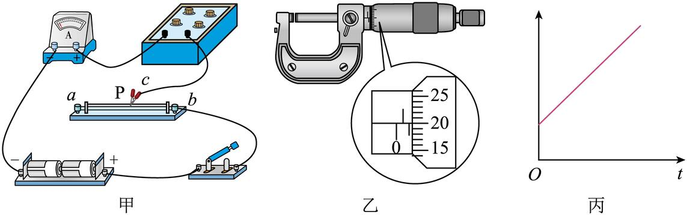

# Physics - 题目 716

**ID**: 0460ed2ea0ac4a39869e6eb53ab424cf
**年级**: Grade 12
**难度**: Medium
**题型**: Experiment

## 题目
如图甲所示的电路可以用来测量电阻丝的电阻率，电阻丝ab与电流表A及电阻箱串联接入电路，电阻箱起到短路保护作用，电阻丝ab被固定在带有刻度的木板上，P是鳄鱼夹，用来调整接入电路中的电阻丝长度l。​​​​​​​‌（1）实验中用螺旋测微器测得电阻丝的直径如图乙所示，其示数为d=mm。（2）实验开始前把电阻箱的阻值调整到R_{0}，然后闭合开关，从左向右逐渐改变鳄鱼夹的位置，记录下鳄鱼夹每一个位置对应的bc长度l及对应的电流表A的示数I，得到多组（l，I）数据。（3）利用图像法处理数据，建立平面直角坐标系，以接入电路的电阻丝长度l为横轴，以（选填“I”或“ $\frac {1}{I}$ ”）为纵轴，再根据实验数据在坐标系中描点，并且把这些点拟合为一条直线，如图丙所示。（4）如果（3）中图丙所拟合的直线的斜率为k，纵轴截距为b，金属丝的直径为d，本实验所用的电源电动势为E，则金属丝的电阻率ρ=。（5）仅从实验设计原理上看，用上述方法得到的金属丝的电阻率的测量值与真实值相比（选填“偏大”“偏小”或“相等”）。

## 解答

1. （1）[1]由图乙可知 $d=1{\rm{m}}{\rm{m}}+20.0\times 0.01{\rm{m}}{\rm{m}}=1.200{\rm{m}}{\rm{m}}$
2. （3）[2] 根据闭合电路欧姆定律 $I=\frac {E}{r+R{{}_{0}}+R{{}_{x}}}$ ，推导得 $\frac {1}{I}=\frac {r+R{{}_{0}}}{E}+\frac {R{{}_{x}}}{E}$ ，根据电阻定律 $R{{}_{x}}=ρ\frac {l}{S}$ ，电阻丝ab的横截面积 $S=\frac {πd{^{2}}}{4}$ ，联立解得 $\frac {1}{I}=\frac {r+R{{}_{0}}}{E}+\frac {4ρ}{πEd{^{2}}}l$ ，结合图像判断，以 $\frac {1}{I}$ 为纵轴。
3. （4）[3] 根据（3）得到的关系，图象的斜率 $k=\frac {4ρ}{πEd{^{2}}}$ ，解得 $ρ=\frac {kπEd{^{2}}}{4}$
4. （5）[4] 根据闭合电路欧姆定律，测量 $I=\frac {E}{r+R{{}_{0}}+R{{}_{x}}}$ ，实际 $I{{}_{实}}=\frac {E}{r{{}_{1}}+r{{}_{{\rm{A}}}}+R{{}_{0}}+R{{}_{x}}}$ ，整理可得 $\frac {1}{I{{}_{实}}}=\frac {r+R{{}_{0}}+R{{}_{{\rm{A}}}}}{E}+\frac {4ρ}{πEd{^{2}}}l$ ，对比分析知测量电源内阻r包括电源电阻 $r{{}_{1}}$ 和电流表内阻 $r{{}_{{\rm{A}}}}$ 两部分，会影响电源内阻的测量，而电流表内阻不会影响到 $R{{}_{x}}$ 的测量，不会影响电阻率的测量值，电阻率的测量值与真实值相等。

## 知识点

**中文**:
  - 实验：导体电阻率的测量

**English**:
  - Experiment: Measuring Resistivity

---
