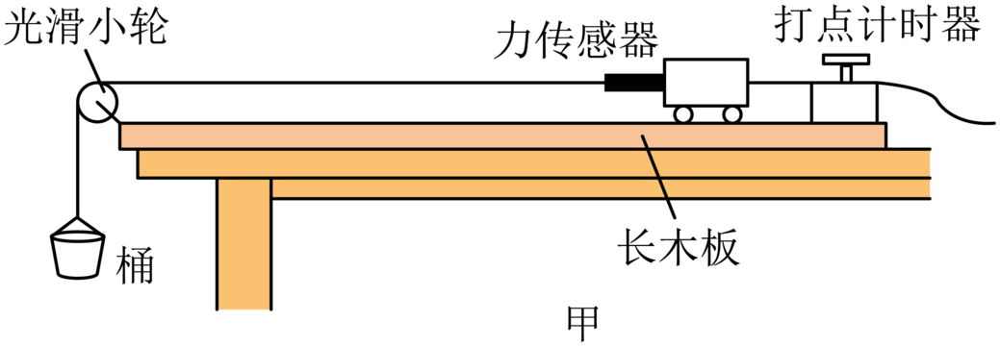

# Physics - 题目 1420

**ID**: 14282ad36d4442b5b0e3554e46c70f16
**年级**: Grade 12
**难度**: Medium
**题型**: Experiment

## 题目
某同学利用如图甲所示的实验装置利用力传感器“探究加速度与力、质量的关系”。​​​​​​​‌(1)关于本实验的操作，下列做法正确的是。

## 解答

1. （1）A．平衡摩擦，不需要悬挂空桶，选项A错误；
2. B．该方案操作时有力传感器测量小车受的拉力，则不需要满足桶的质量远小于小车的质量，选项B错误；
3. C．为了改变小车的质量，可以在小车中增减砝码的数量，选项C正确；
4. D．应先接通电源，后释放小车，选项D错误。选C。
5. （2）连成直线，如图所示.
6. 

## 知识点

**中文**:
  - 实验：探究加速度与力、质量的关系

**English**:
  - Experiment: Acceleration vs Force and Mass (Newton's 2nd Law)

---
