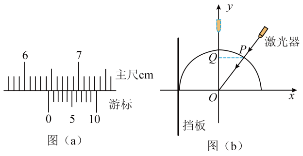

# Physics - 题目 2486

**ID**: 161a69c74d494fb098c15a026daf8319
**年级**: Grade 12
**难度**: Medium
**题型**: Experiment

## 题目
某同学测量一半圆形透明玻璃砖的折射率，实验过程如下：①用游标卡尺测量玻璃砖的直径d，确定其底面圆心位置并标记在玻璃砖上；②将玻璃砖放在位于水平桌面并画有直角坐标系Oxy的白纸上，使其底面圆心和直径分别与O点和x轴重合，将一长直挡板紧靠玻璃砖并垂直于x轴放置，如图（b）所示；③用激光器发出激光从玻璃砖外壁始终指向O点水平射入，从y轴开始向右缓慢绕O点移动激光器，直至恰好没有激光从玻璃砖射出至挡板上y﹤0的区域时，在白纸上记录激光束从玻璃砖外壁入射的位置P。​​​​​​​‌④取走玻璃砖，过P点作y轴的垂线PQ，用刻度尺测量PQ的长度L。根据以上步骤，回答下列问题：（1）测得半圆形玻璃砖直径d的读数如图（a）所示，则d=cm；（2）步骤③中，没有激光射至挡板上y﹤0区域的原因是激光束在玻璃砖直径所在界面处发生了（选填“折射”或“全反射”）；（3）根据以上测量的物理量，若测得PQ线段的长度L=2.00cm，计算可得玻璃砖的折射率为n=。（结果保留3位有效数字）

## 解答

1. （1）游标卡尺读数 ${\rm \mathit{d}=}6.4{\rm{c}}{\rm{m}}+0.1\times 3{\rm{m}}{\rm{m}}{\rm{=}}{{6}}{{.}}{{4}}{{3}}{\rm{c}}{\rm{m}}$
2. （2）步骤③中，没有激光射至挡板上y﹤0区域的原因是激光束在玻璃砖直径所在界面处发生了全反射。
3. （3）玻璃砖的折射率为 ${\rm \mathit{n}=}\frac {1}{\sin C}=\frac {1}{\frac {PQ}{\frac {d}{2}}}=1.61$

## 知识点

**中文**:
  - 实验：测量玻璃或其他物质的折射率

**English**:
  - Experiment: Measuring Refractive Index

---
