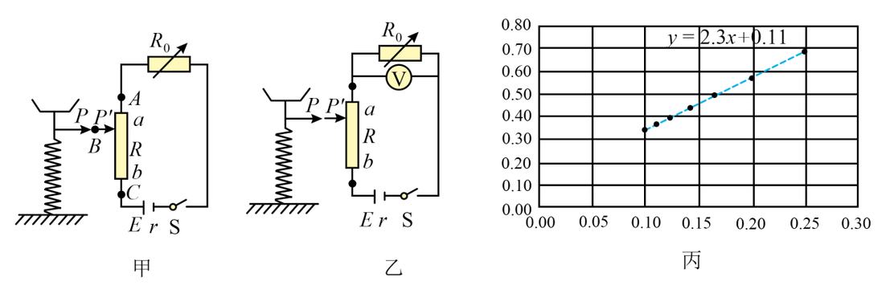

# Physics - 题目 1150

**ID**: 25b8fe033d1a4bb7b0e7456f992f850f
**年级**: Grade 12
**难度**: Medium
**题型**: Experiment

## 题目
某同学根据所学知识，用带托盘的弹簧、电池组、电阻箱、滑动变阻器、内电阻很大的电压表（量程为0-3V）等元件制作了一台简易电子秤。​​​​​​​‌弹簧下端固定在可竖直升降的平台上，弹簧上端固定有托盘和水平指针P，滑动变阻器竖直固定，滑片P′朝向指针P。滑动变阻器的最大阻值R=20Ω，ab是滑动变阻器有电阻丝缠绕的部分，弹簧始终处于弹性限度内。(1)图甲所示为电子秤的部分原理图。①当托盘中没有放物体时，调节滑片，使滑片P′处于滑动变阻器的a点，调节平台使P正对P′。托盘中放入待测物体后，调滑片P′，使P′正对P。②闭合开关，为使电压表示数随待测物体的质量的增大而均匀增大，应将电压表连接在图甲的B点与点（选填“A”或“C”）③在托盘里放入1.0kg的砝码，调节滑片P′，P正对P时，此时电压表读数为1.60V，则该电子秤可测量的最大质量为kg（结果保留2位有效数字），秤盘和弹簧的质量对电子秤的测量结果（选填“有”或“无”）影响。(2)该同学为了测量出电子秤内电池组的电动势和内阻，将电压表并联在R_{0}两端，如图乙所示。进行了如下操作：改变电阻箱的阻值R_{0}，记录电压表的对应的读数U_{0}，用WPS表格处理多次测量的数据得到如图丙所示的图像，该图像的函数关系式为y=2.3x+0.11。其中横坐标为 $\frac {1}{R{{}_{0}}}$ ，纵坐标为 $\frac {1}{U{{}_{0}}}$ ，则由图丙可得电池组的电动势E=V，内阻r=Ω（结果均保留2位有效数字）

## 解答

1. （1）②[1]根据闭合电路欧姆定律可知电路中的电流不变，待测物体的质量的增大时，滑动变阻器上半部分的电阻增大，则电压表应接在图甲的B点与A点:。
2. ③[2][3]设滑动变阻器单位长度的电阻为r，则电压表的示数为U=Irx，根据胡克定律可知kx=mg，则电压表示数与质量正相关，电压表量程为3V，则有 $\frac {m}{U}=\frac {m^{′}}{U^{′}}$  ； 解得m'= 1.9kg， 秤盘和弹簧的质量对电子秤的测量结果无影响。
3. （2）[1][2]根据闭合电路欧姆定律有 $E=U{{}_{0}}+\frac {U{{}_{0}}}{R{{}_{0}}}\left ({R+r}\right )$ ， 变形可知  $\frac {1}{U{{}_{0}}}=\frac {1}{E}+\frac {R+r}{E}\frac {1}{R{{}_{0}}}$ ，结合图像的斜率与截距可知 $\frac {1}{E}=0.11$ ， $\frac {R+r}{E}=2.3$ ，解得 $E=9.1{\rm{V}}$ ， $r=0.91{\rm{Ω}}$

## 知识点

**中文**:
  - 实验：电池电动势和内阻的测量—伏阻法测定电源的电动势与内阻

**English**:
  - V-R Method for EMF and Internal Resistance

---
