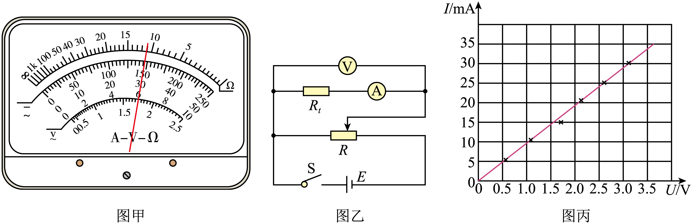

# Physics - 题目 646

**ID**: 36d65309ef9b4c108eb4b8a8feef2885
**年级**: Grade 12
**难度**: Medium
**题型**: Experiment

## 题目
某实验小组准备设计核心元件为热敏电阻的温控报警系统，为实现温度升高至 $60℃$ 时启动报警系统，该小组成员研究了 $60℃$ 时某热敏电阻的伏安特性曲线。​​​​​​​‌(1)某成员将热敏电阻放置于 $60℃$ 的恒温槽中，先利用多用电表欧姆“ $\times 10$ ”挡进行阻值粗测，示数如图甲所示，则该温度下热敏电阻阻值约为${\rm{Ω}}$ ；(2)小南同学设计了如图乙所示的电路研究 $60℃$ 时该热敏电阻的伏安特性曲线。所用实验器材有：

## 解答

1. （1）用电表欧姆“ $\times 10$ ”挡进行阻值粗测，示数如图甲所示，则该温度下热敏电阻阻值约为 $11\times 10Ω=110Ω$
2. （2）[1]电路中的最大电流 $I{{}_{{\rm \max }}}=\frac {4}{110}\approx 0.036{\rm{A}}=36{\rm{m}}{\rm{A}}$
3. 为了减小误差，则电流表应选取 ${\rm{A}}{{}_{2}}$ ；
4. [2]根据题图可知，滑动变阻器采用分压式连接，为了方便调节，所以滑动变阻器选用最大阻值较小的 $R{{}_{2}}$ ；
5. [3]由图可知， $60℃$ 时待测热敏电阻的阻值 $R{{}_{t}}=\frac {3.0}{0.028}Ω\approx 107Ω$

## 知识点

**中文**:
  - 金属热电阻、热敏电阻

**English**:
  - Metal Resistance Thermometers and Thermistors

---
