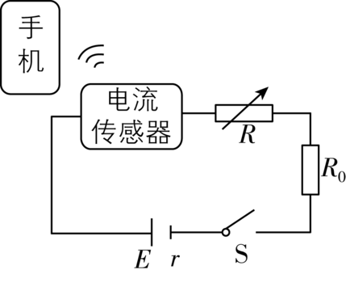
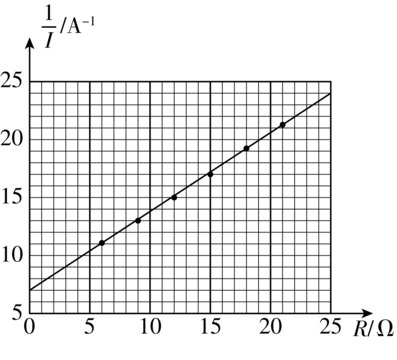

# Physics - 题目 1339

**ID**: 4d4c63222adf47eab9c808a8bf0a3d83
**年级**: Grade 12
**难度**: Medium
**题型**: Experiment

## 题目
某实验小组为测量一节干电池的电动势E和内阻r,设计了如图(a)所示电路,所用器材如下:干电池、智能手机、电流传感器、定值电阻R_{0}、电阻箱、开关、导线等。​​​​​​​‌按电路图连接电路,将智能手机与电流传感器通过蓝牙无线连接,闭合开关S,逐次改变电阻箱的阻值R,用智能手机记录对应的电流传感器测得的电流I。回答下列问题:图(a)图(b)(1)R_{0}在电路中起　　　　(填“保护”或“分流”)作用。(2) $\frac{1}{I}$ 与E、r、R、R_{0}的关系式为 $\frac{1}{I}{\rm =}$ 　　　　。(3)根据记录数据作出 $\frac{1}{I}{\rm -\mathit{R}}$ 图像,如图(b)所示。已知R_{0}=9.0 Ω,可得E=　　　　V(保留三位有效数字),r=　　　　Ω(保留两位有效数字)。(4)电流传感器的电阻对本实验干电池内阻的测量结果　　　　(填“有”或“无”)影响。

## 解答

1. (1)R_{0}串联在电路中,起保护作用。
2. (2)由闭合电路欧姆定律得E=I(R+R_{0}+r),整理得 $\frac{1}{I}{\rm =}$  $\frac{1}{E}{\rm (\mathit{R}+\mathit{r}+\mathit{R}_{0})}$ 。
3. (3)根据上述分析,结合题图(b)可知, $\frac{1}{E}{\rm =}$  $\frac{17}{25}$   ${\rm V^{-1},}\frac{{R}_{0}+r}{E}{\rm =7}$  A^{-1},解得E=1.47 V,r=1.3 Ω。
4. (4)电流传感器有内阻时,E=I(R+R_{0}+r_{真}+R_{A}),解得 $\frac{1}{I}{\rm =}$  $\frac{1}{E}{\rm \mathit{R}+}$  $\frac{{R}_{0}+{r}_{\mathrm{真}}+{R}_{\mathrm{A}}}{E}$ ,则 $\frac{{R}_{0}+{r}_{\mathrm{真}}+{R}_{\mathrm{A}}}{E}{\rm =7}$  A^{-1},则r_{测}=r_{真}+R_{A},故电流传感器的电阻对干电池内阻的测量结果有影响。

## 知识点

**中文**:
  - 实验：电池电动势和内阻的测量—安阻法测量电源电动势与内阻

**English**:
  - A-R Method for EMF and Internal Resistance

---
