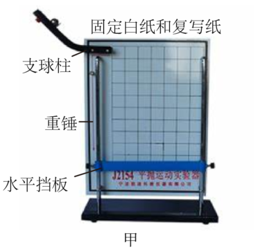
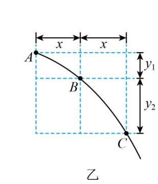
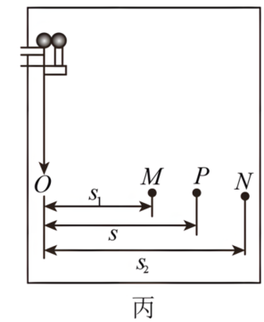

# Physics - 题目 2060

**ID**: 5603e7890a284dcdb21afc9d0603c594
**年级**: Grade 12
**难度**: Medium
**题型**: Experiment

## 题目
某同学用平抛和碰撞实验器可以完成“研究平抛运动规律”和“验证动量守恒定律”两个实验。​​​​​​​‌实验装置如图甲所示：在“研究平抛运动规律”实验中，将白纸和复写纸对齐重叠并固定在竖直的硬板上。钢球沿斜槽轨道滑下后从斜槽末端飞出，落在水平挡板上。由于挡板靠近硬板一侧较低，钢球落在挡板上时，钢球侧面会在白纸上挤压出一个痕迹点。移动挡板，重新释放钢球，如此重复，白纸上将留下一系列痕迹点。在“验证动量守恒定律”实验中，固定挡板位置，实验时先让钢球从斜槽上某一固定位置由静止开始滚下，落到挡板处，在下面的白纸上留下痕迹。重复上述操作5次，得到5个落点痕迹，找到平均落点。把半径与钢球相同的玻璃靶球放在收放自如的支球柱上，让钢球仍从固定位置由静止开始滚下，两球正碰后，分别在白纸上留下各自的落点痕迹，重复操作5次，找到各自的平均落点。(1)下列关于实验操作的说法正确的是（填选项前的字母）。

## 解答

1. （1）A．平抛实验不需测量钢球直径，A错误；
2. B．“研究平抛运动规律”实验不需要测出钢球的质量，“验证动量守恒定律”实验需用天平测出钢球的质量，B错误；
3. C．两个实验中均需保证斜槽轨道末端切线水平，保证小球做平抛运动，C正确；
4. D．钢球与斜槽之间的摩擦力对实验无影响，两个实验中均不需减小钢球与斜槽之间的摩擦力，D错误。选C。
5. （2）[1]由于平抛的竖直分运动是自由落体运动，相邻相等时间内竖直方向上的位移之比为1：3：5 ...，两相邻相等时间内竖直方向上的位移之比越来越大，由于A点不是抛出位置，因此 $\frac {y{{}_{1}}}{y{{}_{2}}}>\frac {1}{3}$
6. [2]由 $y{{}_{2}}-y{{}_{1}}=gT{^{2}}$ ， $x=v{{}_{0}}T$ ，联立解得 $v{{}_{0}}=x\sqrt {\frac {g}{y{{}_{2}}-y{{}_{1}}}}$
7. （3）设入射球滚至斜槽轨道末端速度为 $v{{}_{0}}$ ，与靶球碰撞后速度分别为 $v{{}_{1}}$ ， $v{{}_{2}}$ ，由动量守恒定律可知，所要验证的表达式为 $m{{}_{1}}v{{}_{0}}=m{{}_{1}}v{{}_{1}}+m{{}_{2}}v{{}_{2}}$ ，碰撞后两球飞出做平抛运动，由 $h=\frac {1}{2}gt{^{2}}$ ，可知下落时间相同，由 $v=\frac {x}{t}$ ，可知入射球两次的速度分别为 $v{{}_{0}}=\frac {s}{t}$ ， $v{{}_{1}}=\frac {s{{}_{1}}}{t}$ ，靶球的速度为 $v{{}_{2}}=\frac {s{{}_{2}}-d}{t}$ ，要验证动量守恒定律的表达式为 $m{{}_{1}}s=m{{}_{1}}s{{}_{1}}+m{{}_{2}}\left ({s{{}_{2}}-d}\right )$

## 知识点

**中文**:
  - 实验：探究平抛运动的特点

**English**:
  - Experiment: Characteristics of Projectile Motion

---
