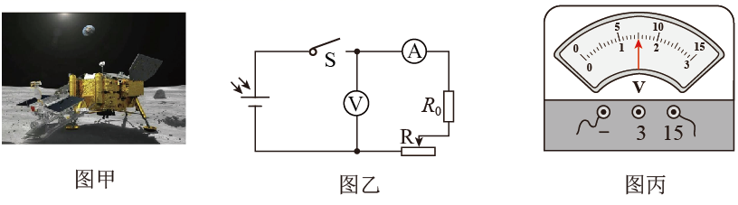
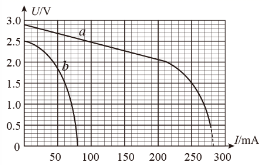

# Physics - 题目 2450

**ID**: 562c3ab3d1e34d7b900f12eb8cf8819f
**年级**: Grade 12
**难度**: Medium
**题型**: Experiment

## 题目
举世瞩目的嫦娥四号，其能源供给方式实现了新的科技突破：它采用同位素温差发电与热电综合利用技术结合的方式供能，也就是用航天器两面太阳翼收集的太阳能和月球车上的同位素热源两种能源供给探测器。​​​​​​​‌图甲中探测器两侧张开的是光伏发电板，光伏发电板在外太空将光能转化为电能。某同学利用图乙所示电路，探究某光伏电池的路端电压U与电流I的关系，图中定值电阻 $R{{}_{0}}=5{\rm{Ω}}$ ，设相同光照强度下光伏电池的电动势不变，电压表、电流表均可视为理想电表。（1）实验一：用一定强度的光照射该电池，闭合电键S，调节滑动变阻器R的阻值。通过测量得到该电池的 $U-I$ 曲线a（如图丁）。由此可知，该电源内阻是否为常数（填“是”或“否”），某时刻电压表示数如图丙所示，读数为V，由图像可知，此时电源内阻为${\rm{Ω}}$ （计算结果保留两位有效数字）（2）实验二：在实验一中当滑动变阻器的电阻为某值时路端电压为2.5V，减小实验一光照的强度，重复实验，测得 $U-I$ 曲线b（如图丁），则在实验二中滑动变阻器仍为该值时，滑动变阻器消耗的电功率为W（计算结果保留两位有效数字）。

## 解答

1. (1)[1]根据电源的U-I图像表示电源的内阻，由图像可知，图像的斜率不是定值，故电源的内阻不是定值；
2. [2]由图丙可知量程为0~3V，读数要估读一位，故此时电压表的读数为1.50V；
3. [3]由图像a，知在路端电压为1.5V时，此时电路中的电流为I=0.25A，根据闭合电路欧姆定律得
4. $E=U+Ir$
5. 可得
6. $r=5.6{\rm{Ω}}$
7. (2)[4]在a图线中，路端电压为2.5V，则此时对应的电流为I=0.1A，设滑动变阻器值阻值为R，由欧姆定律得
8. $I{{}_{1}}(R+R{{}_{0}})=2.5$
9. 代入数据得
10. $R+R{{}_{0}}=25{\rm{Ω}}$
11. 
12. 图线交点坐标为 $(1.4，63)$ ，故R消耗的功率
13. $P=U{{}_{R}}I{{}_{R}}=1.4\times \frac {20}{25}\times 63\times 10{^{-3}}{\rm{W}}{\rm{=}}{\rm{7}}{\rm{.}}{\rm{1}}\times 10{^{-2}}{\rm{W}}$

## 知识点

**中文**:
  - 实验：电池电动势和内阻的测量—伏安法测量电源电动势与内阻

**English**:
  - V-A Method for EMF and Internal Resistance

---
