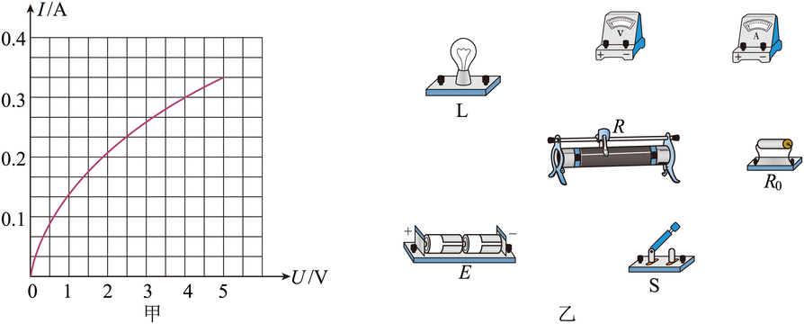
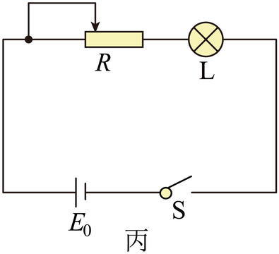

# Physics - 题目 1900

**ID**: 6160f707e35c45ba9b3473e99708334f
**年级**: Grade 12
**难度**: Medium
**题型**: Experiment

## 题目
小灯泡 ${\rm{L}}$ 的说明书上标明额定电压为 $4.5{\rm{V}}$ ，伏安特性曲线如图甲所示。​​​​​​​‌某同学通过实验验证它的伏安特性，所使用的器材有：电压表 ${\rm{V}}$ （量程 $5{\rm{V}}$ ，内阻 $5{\rm{k}}{\rm{Ω}}$ ）；电流表 ${\rm{A}}$ （量程 $0.2{\rm{A}}$ ，内阻 $2{\rm{Ω}}$ ）；定值电阻 $R{{}_{0}}$ （阻值 $2{\rm{Ω}}$ ）；滑动变阻器 $R$ （阻值 $0\sim 8.0{\rm{Ω}}$ ）；电源 $E$ （电动势 $6{\rm{V}}$ ，内阻不计）；开关 ${\rm{S}}$ ；导线若干。（1）实验要求能够实现在 $0\sim 4.5{\rm{V}}$ 的范围内对小灯泡的电压进行测量，在答题卡的虚线框内画出实验电路原理图。（2）请根据原理图，用笔画线代替导线在图乙实物接线图中完成导线的连接。（3）经验证，小灯泡 ${\rm{L}}$ 的伏安特性曲线与说明书上的一致。现用另一电源 $E{{}_{0}}$ （电动势 $4{\rm{V}}$ ，内阻 $2.0{\rm{Ω}}$ ）和小灯泡 ${\rm{L}}$ 、滑动变阻器 $R$ 、开关 ${\rm{S}}$ 以及导线连接成图丙所示的电路。滑动变阻器的滑片在最左端时闭合开关 ${\rm{S}}$ ，稳定后小灯泡的电阻 $R{{}_{{\rm{L}}}}=$${\rm{Ω}}$ 。调节滑动变阻器 $R$ 的阻值，在可变化范围内，小灯泡的最大功率 $P{{}_{{\rm{m}}{\rm{a}}{\rm{x}}}}=$W。（结果均保留2位有效数字）

## 解答

1. （1）实验要求能够实现在 $0\sim 4.5{\rm{V}}$ 的范围内对小灯泡的电压进行测量，应采取分压法，电流表量程太小，应并联定值电阻 $R{{}_{0}}$ 增大量程，如图
2. 
3. （2）如图
4. 
5. （3）根据闭合电路欧姆定律 $E{{}_{0}}=U+I(R+r)$ ；整理得 $I=\frac {E{{}_{0}}-U}{R+r}=\frac {4-U}{10}=-0.1U+0.4$ ；在小灯泡 ${\rm{L}}$ 的伏安特性曲线上作图
6. 
7. 交点对应电压U=1.9V，电流 ${\rm \mathit{I}=0.21A，}R{{}_{{\rm{L}}}}=\frac {U}{I}=9.0\Omega $ ，当滑动变阻器接入电路中电阻为零时，灯泡功率最大，此时电源内阻 $2.0{\rm{Ω}}$ ，作出电源的伏安特性曲线（虚线）如图交点对应电压U_{1}=3.48V，电流I_{1}=0.27A，小灯泡的最大功率 $P{{}_{{\rm{m}}{\rm{a}}{\rm{x}}}}=U{{}_{1}}I{{}_{1}}={\rm 0.94W}$ 。

## 知识点

**中文**:
  - 实验：描绘小灯泡的伏安特性曲线

**English**:
  - Experiment: V-A Characteristic Curve of Small Bulb

---
