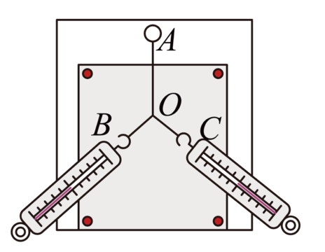

# Physics - 题目 1498

**ID**: 632d8dd3c82c431d9a08d76964f27730
**年级**: Grade 12
**难度**: Medium
**题型**: Experiment

## 题目
（1）某同学做“验证力的平行四边形定则”的实验如图所示，其中A为固定橡皮条的图钉，O为橡皮条与细绳的结点，OB和OC为细绳。​​​​​​​‌关于本实验，下列说法中正确的是。

## 解答

1. （1）记录拉力方向时不可以用铅笔贴着细绳画直线表示，正确方法是在细绳上离O点适当远处找一点，该点与O点的连线就是拉力的方向，故A错误；测量时，弹簧测力计外壳与木板之间可以存在摩擦，不影响测量，故B正确；为减小测量误差， $F{{}_{1}}$ 、 $F{{}_{2}}$ 方向间的夹角不宜太大，也不宜太小，适当就行，不一定是 $90{}\degree $ ，故C错误；使用弹簧测力计时，施力方向应沿着弹簧测力计的轴线，读数时视线正对弹簧测力计刻度，以减小实验误差，故D正确。
2. （2）根据二力平衡条件， $F^{′}$ 一定与橡皮筋在同一直线上；F是根据平行四边形定则得到的合力，一定是平行四边形的对角线。故C正确，ABD错误。

## 知识点

**中文**:
  - 实验：探究两个互成角度的力的合成规律

**English**:
  - Experiment: Parallelogram Rule of Forces

---
