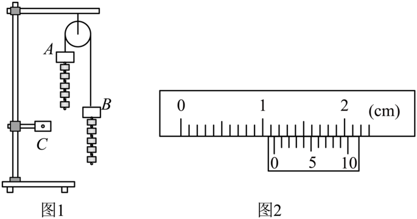

# Physics - 题目 1447

**ID**: 6b60e32e4c0a4d9a80ca1a92693aaaaf
**年级**: Grade 12
**难度**: Medium
**题型**: Experiment

## 题目
某实验小组用如图1所示的实验装置测当地重力加速度，物块A装有一宽度很小的挡光片，A（含挡光片）和B的质量 $m{{}_{A}}=m{{}_{B}}=M{\rm ，\mathit{A}}$ 、B下端分别悬挂5个相同质量的钩码，每个钩码的质量为 $m$ ，光电门 ${\rm C}$ 与数字计时器相连（图中未画出），可记录遮光片通过光电门的时间。​​​​​​​‌实验时挡光片通过光电门时，物块B没有到达轻质定滑轮处。（1）如图2所示，用游标卡尺测量遮光片的宽度，遮光片的宽度 $d=$mm。（2）从物块B的下端摘下1个钩码并挂在物块A下端的钩码下面，由静止释放系统，释放时挡光片距光电门上方高为 $h$ ，计时器记录挡光片通过光电门的时间为 ${\rm{Δ}}t$ ，取 $n=1$ 。（3）该同学每次从物块B的下端摘下1个钩码并挂在物块A下端的钩码下面，保持挡光片距光电门高为 $h$ 的位置由静止释放，进行多次实验，依次取 $n\mathrm{=}2$ 、 $3$ 、 $4$ 、 $5$ 。（4）根据实验数据，作出 $\frac {1}{{\rm{Δ}}t{^{2}}}-n$ 图像为一倾斜直线，直线斜率为 $k$ ，则当地的重力加速度的表达式为（用 $k$ ， $M$ ， $m$ ， $d$ ， $h$ 表示）。（5）误差分析可得，重力加速度的测量值（填“大于”“小于”或“等于”）真实值，理由是（填一种即可）。

## 解答

1. （1）遮光片的宽度 $d=11{\rm{m}}{\rm{m}}+4\times 0.1{\rm{m}}{\rm{m}}=11.4{\rm{m}}{\rm{m}}$ 。
2. （4）挡光片经过光电门的速度 $v=\frac {d}{{\rm{Δ}}t}$ ，据速度－位移公式有 $a=\frac {v{^{2}}}{2h}$ ，对A、B及钩码整体，根据牛顿第二定律有 $2nmg=\left ({2M+10m}\right )a$ ，由上式可得 $\frac {1}{({\rm{Δ}}t){^{2}}}=\frac {2mgh}{\left ({M+5m}\right )d{^{2}}}n$ ，又因为斜率为 $k$ ，可得 $\frac {2mgh}{\left ({M+5m}\right )d{^{2}}}=k$ ，即 $g=\frac {\left ({M+5m}\right )d{^{2}}k}{2mh}$ 。
3. （5）由于摩擦阻力、空气阻力和滑轮质量的影响，会导致 $a$ 的实验值比理论值小，重力加速度测量值小于真实值。

## 知识点

**中文**:
  - 实验：探究加速度与力、质量的关系

**English**:
  - Experiment: Acceleration vs Force and Mass (Newton's 2nd Law)

---
