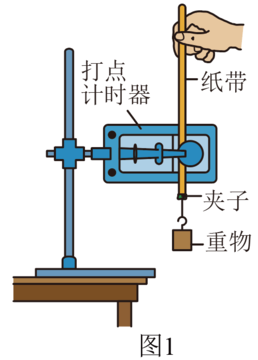
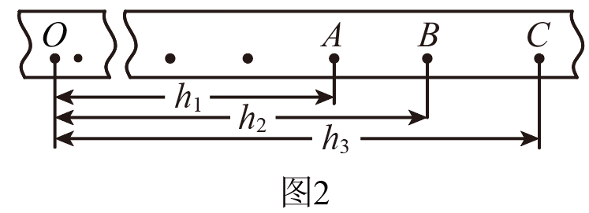
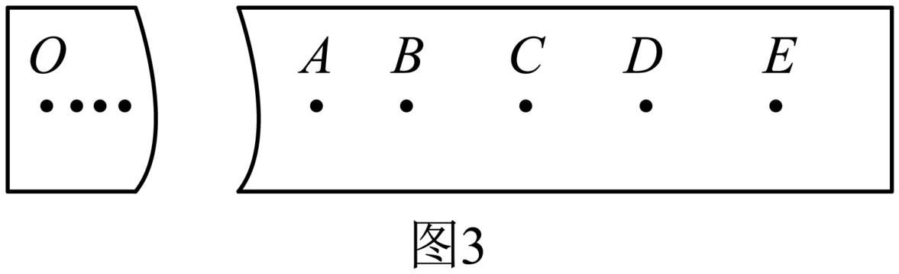

# Physics - 题目 1680

**ID**: 739fb997aaf84a1bb9c13748bab656a7
**年级**: Grade 12
**难度**: Medium
**题型**: Experiment

## 题目
利用图1所示的装置进行“验证机械能守恒定律”实验；​​​​​​​‌(1)实验操作步骤如下，请将第二步补充完整：第一步：按实验要求安装好实验装置；第二步：使重物靠近打点计时器，接着，打点计时器在纸带上打下一系列的点；

## 解答

1. （1）为打点稳定，充分利用纸带，打点计时器打点时应先接通电源后释放纸带。
2. （2）重物重力势能的减少量为 $ΔE{{}_{{\rm{p}}}}=mgh{{}_{2}}$ ；
3. 相邻两计数点的时间间隔为 $T=\frac {1}{f}$ ，根据匀变速直线运动中间时刻的瞬时速度等于该过程平均速度， $B$ 点的速度为 $v{{}_{B}}=\frac {\Delta x}{\Delta t}=\frac {h{{}_{3}}-h{{}_{1}}}{2T}$ ，动能的增加量为 $ΔE{{}_{{\rm{k}}}}=\frac {1}{2}mv{{}_{B}^{2}}=\frac {m(h{{}_{3}}-h{{}_{1}}){^{2}}}{8T{^{2}}}=\frac {m(h{{}_{3}}-h{{}_{1}}){^{2}}f{^{2}}}{8}$ 。
4. （3）若不慎将上述纸带从OA之间扯断可以将A点后面的纸带上取出两个点，分别计算出通过两点的动能，测量出这两点的高度差，计算出两点的动能增量是否和重力势能的减小量相等从而验证机械能守恒定律，即能实现验证机械能守恒定律的目的。

## 知识点

**中文**:
  - 实验：验证机械能守恒定律

**English**:
  - Experiment: Verifying Conservation of Mechanical Energy

---
