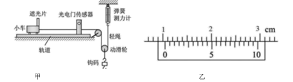

# Physics - 题目 1491

**ID**: 927ade243d73485eb98bb23c2a809409
**年级**: Grade 12
**难度**: Medium
**题型**: Experiment

## 题目
如图甲所示的装置可以完成多个力学实验。​​​​​​​‌第1小组利用该装置“研究匀变速直线运动”，第2小组利用该装置“验证牛顿第二定律”，第3小组将长木板放平，并把小车换成木块，“测定长木板与木块间的动摩擦因数”。（1）第1小组用20分度的游标卡尺测量遮光片的宽度 $d$ ，示数如图乙，则 $d=$mm。（2）关于第1、2两小组的实验，说法正确的是。

## 解答

1. （1）遮光片的宽度 $d=10{\rm{\;}}{\rm{c}}{\rm{m}}+11\times 0.05{\rm{\;}}{\rm{m}}{\rm{m}}={{1}}{{0}}{{.}}{{5}}{{5}}{\rm{\;}}{\rm{m}}{\rm{m}}$ 。
2. （2）A．用此装置研究匀变速直线运动时，摩擦力并不影响小车做匀变速直线运动，故不需要平衡摩擦力，A错误；
3. B．乙小组实验时，需要知道合外力，需要平衡摩擦力，B正确；
4. C．甲小组实验时，不要求钩码的质量远小于小车质量，C错误；
5. D．乙小组实验时，可以根据弹簧测力计直接读出力的大小，不要求钩码的质量远小于小车质量，D错误。选B。
6. （3）小车通过光电门的速度 $v=\frac {d}{Δt}$ ，加速度 $a=\frac {F}{M}$ ，根据 $v{^{2}}=2as$ ，得 $F=\frac {Md{^{2}}}{2s{\left({{\rm{Δ}}t}\right)^{2}}}$ ；
7. （4）小车通过光电门的速度 $v=\frac {d}{Δt}$ ，根据动能定理 $Fs-μMgs=\frac {1}{2}Mv{^{2}}$ ，得 $F=\frac {M}{2s}v{^{2}}+μMg$ ，由图像知 $a=μMg$ ， $\frac {M}{2s}=\frac {a}{b}$ ，联立可得 $μ=\frac {b}{2gs}$ ；
8. （5）根据 $μ=\frac {b}{2gs}$ 可知丙研究小组在实验中测量位移s时未考虑遮光片的丙宽度d，动摩擦因数 $μ$ 的测量值大于真实值。

## 知识点

**中文**:
  - 创新实验—测量动摩擦因数
  - 实验：探究加速度与力、质量的关系

**English**:
  - Measuring Coefficient of Kinetic Friction
  - Experiment: Acceleration vs Force and Mass (Newton's 2nd Law)

---
