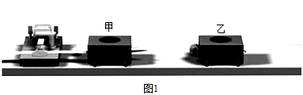
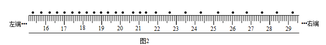

# Physics - 题目 3003

**ID**: 98c4dc20708e4acd844abb045b72ca66
**年级**: Grade 12
**难度**: Medium
**题型**: Experiment

## 题目
某小组在做“探究碰撞中的不变量”实验时，采用了如图1所示的实验装置．小车甲、乙的碰撞端分别装上撞针与橡皮泥．现进行以下操作：把打点计时器固定在光滑水平轨道左侧将纸带一端穿过打点计时器，另一端连在小车甲的后面；打开打点计时器，轻推一下小车甲，使其获得一定速度后与静止的小车乙碰撞粘连成一体；关闭打点计时器，取下纸带，进行相关探究．在某次实验中得到的纸带 $($ 部分 $)$ 如图2所示 $($ 图中的直尺为毫米刻度尺 $)$ ．$\left ({1}\right )$ 请判断小车甲是与图示纸带的$($ “左端”或“右端” $)$ 相连接？并说明理由．$\left ({2}\right )$ 若测量出小车甲的质量为 $524.​​​​​​​‌4{\rm{g}}$ ，小车乙的质量为 $510.0{\rm{g}}$ ，则在这次碰撞中小车甲对小车乙的冲量为$($ 保留两位有效数字 $)$ ．

## 解答

1. （1）甲与乙碰后粘在一起，速度减小，相等时间内的间隔减小，由于纸带右侧速度大，为碰前速度，所以小车甲是与图示纸带的右侧相连．
2. （2）碰后共同速度：
3. $v{{}_{2}}=\frac {19.75-15.75}{10\times 0.02}\times 10{^{-2}}{\rm{m}}{\rm{/}}{\rm{s}}=0.200{\rm{m}}{\rm{/}}{\rm{s}}$
4. 碰后乙的动量：
5. $p{{}_{乙}}=m{{}_{乙}}v{{}_{2}}=0.5100\times 0.200{\rm{k}}{\rm{g}}\cdot {\rm{m}}{\rm{/}}{\rm{s}}=0.102{\rm{k}}{\rm{g}}\cdot {\rm{m}}{\rm{/}}{\rm{s}}\approx {\rm{0}}{\rm{.}}{\rm{1}}{\rm{0}}{\rm{k}}{\rm{g}}\cdot {\rm{m}}{\rm{/}}{\rm{s}}$
6. 由动量定理可得小车甲对小车乙的冲量：
7. $I=p{{}_{乙}}-0=p{{}_{乙}}=0.10{\rm{k}}{\rm{g}}\cdot {\rm{m}}{\rm{/}}{\rm{s}}$
8. 【点睛】
9. 本题考查动量守恒定律实验验证；解决本题的关键知道甲与乙碰后，速度减小，会通过纸带求解速度的大小．

## 知识点

**中文**:
  - 动量与动量定理
  - 实验：以动量守恒为基础的创新实验

**English**:
  - Momentum and Impulse-Momentum Theorem
  - Innovative Experiments Based on Momentum Conservation

---
