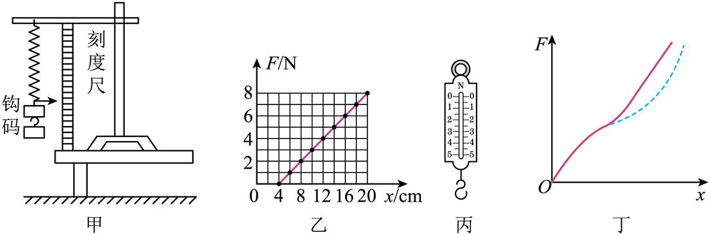

# Physics - 题目 2275

**ID**: b053e686d4f048d3af2c728ea21c5d61
**年级**: Grade 12
**难度**: Medium
**题型**: Experiment

## 题目
为了利用一根弹簧制作一只弹簧测力计，某同学首先用如图甲所示的装置测量了不同弹力大小 $F$ 对应的弹簧长度 $x$ ，然后作出了 $F-x$ 图像，如图乙。​​​​​​​‌请你回答下列问题（题中所有计算结果均保留两位有效数字）：（1）由图乙中的图线可得该弹簧的劲度系数在 $k=$  ${\rm{N}}/{\rm{m}}$ ；（2）利用该弹簧制成一只弹簧测力计如图丙，则测力计上每一大格（1N）的长度为 ${\rm{Δ}}x={\rm cm}$ ；（3）该同学制作完成后想将弹簧替换为橡皮筋，但老师告诉他橡皮筋不适合制作测力计。为了探究原因，他利用图甲装置在不超出橡皮筋弹性限度的情况下，测量了橡皮筋在拉伸和收缩两过程中，不同弹力大小 $F$ 对应的橡皮筋伸长长度 $x$ 。绘制图丁，图丁中实线为拉伸橡皮筋时的 $F-x$ 图线，虚线为收缩橡皮筋的 $F-x$ 图线，由图像可知原因为（只回答一条原因即可）

## 解答

1. （1）根据弹簧的弹力和伸长量满足胡克定律，有 $F=k(x-L{{}_{0}})$ ，则 $F-x$ 图像的斜率表示劲度系数，可得 $k=\frac {ΔF}{Δx}=\frac {8}{(20-4)\times 10{^{-2}}}{\rm{N}}{\rm{/}}{\rm{m}}={{5}}{{0}}{\rm{N}}{\rm{/}}{\rm{m}}$ 。
2. （2）根据胡克定律可知每1N的伸长量为 $Δx=\frac {ΔF}{k}=\frac {1}{50}{\rm{m}}=2.0{\rm{c}}{\rm{m}}$
3. （3）由 $F-x$ 图像可看出弹力随着形变量不是线性变化的，即橡皮筋不满足胡克定律，测力计刻度不均匀（或相同伸长长度对应两个大小不同的力，测量误差大，或非线性）。

## 知识点

**中文**:
  - 实验：探究弹簧弹力和形变量的关系

**English**:
  - Experiment: Investigating Spring Force vs Deformation

---
