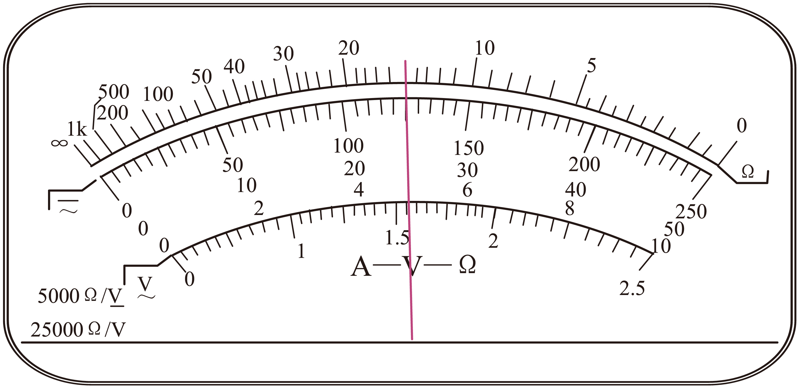

# Physics - 题目 2948

**ID**: c1be6580d17548a2811dce7e65b2a510
**年级**: Grade 12
**难度**: Medium
**题型**: Experiment

## 题目
某兴趣小组要测量程为0~4mA电流计G_{1}的内阻，步骤如下：（1）小组同学先用多用电表的欧姆挡粗测该电流计G_{1}的内阻。​​​​​​​‌当选择开关拨至“×100”挡时发现指针偏转角度过大，他们应该换用挡（填“×10”或“×1000”），换挡并进行正确操作后，指针静止时如右下图所示，则电流计G_{1}的内阻R_{g}_{1}约为Ω。（2）为了准确测量电流计G_{1}的内阻，兴趣小组同学从实验室借来以下器材：电流计G_{2}（量程6mA，内阻R_{g}_{2}约为100Ω）；电压表V（量程6V，内阻R_{V}约为6kΩ）；电源E（电动势3V，内阻很小）；定值电阻R_{1}（阻值为15Ω）；定值电阻R_{2}（阻值为300Ω）；滑动变阻器R_{3}（0~10Ω）；单刀单掷开关S一个，导线若干。①若电表读数不能小于量程的 $\frac {1}{3}$ ，电表应选择（填器材符号）；②在确保实验器材安全的前提下，请根据所提供的实验器材在答题卡对应的虚线框内画出合理的实验电路，并在图上标注实验器材符号；③若实验中电表的读数分别为I_{g}_{1}、I_{g}_{2}或U，则待测表头G_{1}内阻的表达式R_{g}_{1}=。

## 解答

1. （1）[1]当选择开关拨至“×100”挡时发现指针偏转角度过大，表明待测电阻偏小，为了减小欧姆表读数的误差，应该使得指针指在中央刻线附近，则换用小倍率“×10”；
2. [2]根据欧姆表的读数规律，该读数为
3. 15.0×10Ω=150Ω
4. （2）①[3]电源电动势为3V，为了确保电压测量的精度，不能选择6V量程的电压表，由于实验要求准确测量电流计G_{1}的内阻，则可以利用电流计G_{2}与定值电阻间接测量电压，即让定值电阻与电流计G_{1}并联后，再与电流计G_{2}串联，实验要求电表读数不能小于量程的 $\frac {1}{3}$ ，由于
5. $\frac {\frac {1}{3}\times 4\times 10{^{-3}}\times 150}{\frac {1}{3}\times \left ({6-4}\right )\times 10{^{-3}}}Ω=300Ω$
6. 则定值电阻选择R_{2}。
7. ②[4]滑动变阻器R_{3}总阻值为10Ω，比电流计G_{1}的内阻小得多，为了使得测量范围尽可能大，滑动变阻器采用分压式，作出电路图如图所示
8. 
9. ③[5]根据上述电路，电流计G_{1}的内阻为
10. $r{{}_{1}}=\frac {(I{{}_{g2}}-I{{}_{g1}})R{{}_{2}}}{I{{}_{g1}}}$

## 知识点

**中文**:
  - 实验：电表内阻的测量

**English**:
  - Experiment: Measuring Internal Resistance of Meter

---
