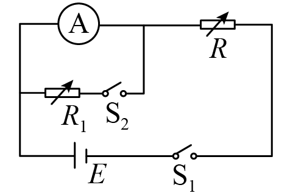

# Physics - 题目 1251

**ID**: cc8e184900fc4fbaa637e63c04422c32
**年级**: Grade 12
**难度**: Medium
**题型**: Experiment

## 题目
有一电流表A，量程为1mA，内阻r_{1}约为100Ω．要求测量其内阻．可选用器材有，电阻箱R_{0}，最大阻值为99999.​​​​​​​‌9Ω；滑动变阻器甲，最大阻值为10kΩ；滑动变阻器乙，最大阻值为2kΩ；电源E_{1}，电动势约为2V，内阻不计；电源E_{2}，电动势约为6V，内阻不计；开关2个，导线若干．采用的测量电路图如图所示，实验步骤如下：a.断开S_{1}和S_{2}，将R调到最大；b.合上S_{1}调节R使A满偏；c.合上S_{2}，调节R_{1}使A半偏，此时可以认为A的内阻r_{g}＝R_{1}，试问：（ⅰ）在上述可供选择的器材中，可变电阻R_{1}应该选择；为了使测量尽量精确，可变电阻R应该选择；电源E应该选择．（ⅱ）认为内阻r_{g}＝R_{1}，此结果与r_{g}的真实值相比．（填“偏大”、“偏小”或“相等”）

## 解答

1. （i）[1]根据半偏法的测量原理，R_{1}必须选电阻箱R_{0}；
2. [2]由于电流表的电阻很小，要求R_{1}的阻值很大，R应选滑动电阻箱甲；
3. [3]电源选择E_{2}，误差较小．
4. （ii）[4]根据闭合电路的欧姆定律及电路特点可得：合上S_{1}，调节R使电流表满偏： $I{{}_{g}}=\frac {E}{R+r{{}_{g}}+r}$  ，合上S_{2}，调节R_{1}使电流表半偏（电路中的总电流）： $I=\frac {{E}}{R+\frac {r{{}_{g}}R{{}_{1}}}{r{{}_{g}}+R{{}_{1}}}+r}$
5. ：I＞I_{g}．所以，通过电阻箱的电流I_{R}_{1}： ${\rm \mathit{I}\mathit{_{R}}_{1}＞}\frac {1}{2}{\rm \mathit{I}\mathit{_{g}}\mathit{_{，}}}$ 用U表示电阻箱两端电压，则 $R{{}_{1}}=\frac {U}{I{{}_{R1}}}＜\frac {{U}}{\frac {I{{}_{g}}}{2}}=r{{}_{g}}$ ，即：r_{g}＞R_{1}：认为内阻r_{g}=R_{1}，此结果与的r_{g}真实值相比偏小。

## 知识点

**中文**:
  - 实验：电表内阻的测量

**English**:
  - Experiment: Measuring Internal Resistance of Meter

---
