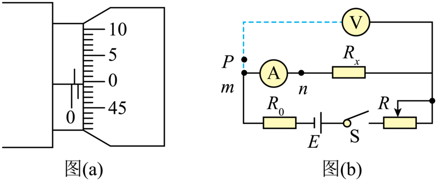

# Physics - 题目 1485

**ID**: d3a1a00e2a464b458bc38ded5237146a
**年级**: Grade 12
**难度**: Medium
**题型**: Experiment

## 题目
家庭照明电路中通常用横截面积为 $1.5{\rm mm}{^{2}}$ 的铜导线进行输电，已知标准铜的电阻率 $ρ{{}_{0}}=1.7\times 10{^{-8}}Ω\cdot {\rm m}$ 。​​​​​​​‌为了探究一卷标有“红色BV   $1.5{\rm mm}{^{2}}$    $500{\rm m}$ ”的铜芯导线纯度是否符合标准，某兴趣小组进行了如下操作：(1)将导线一端的绝缘外层去除，用螺旋测微器测量其内芯直径d，示数如图（a）所示，则 $d=$${\rm mm}$ 。(2)为了测量导线铜芯的电阻率，兴趣小组选用了如下器材：电源E（电动势 $6{\rm V}$ ，内阻不计）滑动变阻器R（阻值 $0\sim 15Ω$ ）定值电阻 $R{{}_{0}}$ （阻值为 $6Ω$ ）电压表V（ $0\sim 3{\rm V}$ ，内阻约为 $3{\rm k}Ω$ ）电流表A（ $0\sim 0.6{\rm A}$ ，内阻约为 $0.05Ω$ ）开关S和导线等图（b）是他们设计的电路。为使测量结果更准确，接线柱P应与（填“m”或“n”）相连。进行正确实验操作后，测得电压和电流分别为U和I，导线长度为L，求得电阻率 $ρ=$（用含字母U、I、d、L、 $π$ 的表达式表示），代入数据算出电阻率与标准值进行比较即可检验该导线铜芯纯度是否达标。

## 解答

1. （1）内芯直径为 $d=1{\rm{m}}{\rm{m}}+49.5\times 0.01{\rm{m}}{\rm{m}}=1.495{\rm{m}}{\rm{m}}$
2. （2）[1]导线铜芯的电阻约为 $R=ρ\frac {L}{S}=1.7\times 10{^{-8}}\times \frac {500}{1.5\times 10{^{-6}}}\Omega \approx 5.7\Omega $ ，电压表内阻远大于导线铜芯的电阻，为减小实验误差，电流表应采用外接法，接线柱P应与n相连。
3. [2]导线铜芯的电阻为 $R=\frac {U}{I}$ ，根据电阻定律 $R=ρ\frac {L}{S}=ρ\frac {L}{π(\frac {d}{2}){^{2}}}$ ，联立解得电阻率 $ρ=\frac {Uπd{^{2}}}{4IL}$

## 知识点

**中文**:
  - 实验：导体电阻率的测量

**English**:
  - Experiment: Measuring Resistivity

---
