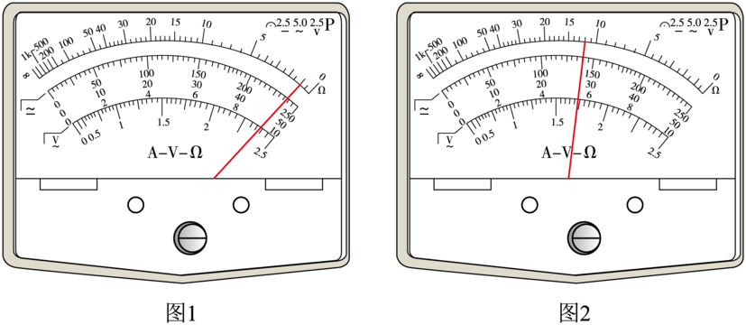
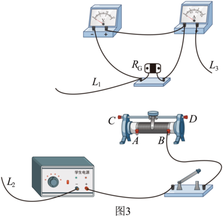
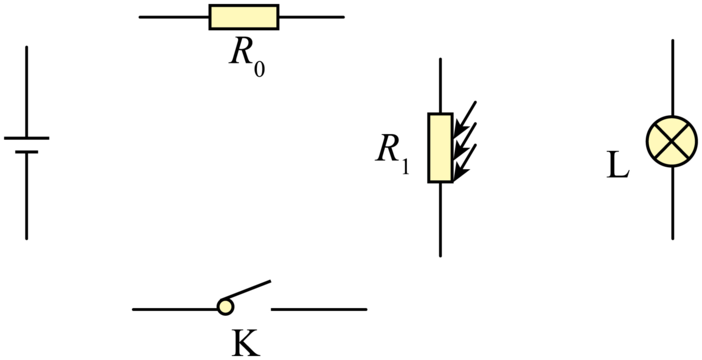

# Physics - 题目 1761

**ID**: f905cfc6ba9a414f852dc09c5a314e94
**年级**: Grade 12
**难度**: Medium
**题型**: Experiment

## 题目
很多路灯可通过光控开关随周围环境的亮度改变进行自动控制，某实验小组利用实验室提供的器材对路灯的内部电路设计进行模拟探究。​​​​​​​‌提供的器材有：电源、定值电阻 $R{{}_{0}}$ （阻值未知）、小灯泡L、光敏电阻 $R{{}_{1}}$ （光照强度增大时，阻值减小）、开关 ${\rm{K}}$ 、导线若干。(1)用多用表测量定值电阻 $R{{}_{0}}$ ，选用“ $\times {\rm 10}$ ”倍率的电阻挡测量，指针位置如图1所示。为减少测量误差，应将选择开关置于（选填“ $\times {\rm 1}$ ”“ $\times {\rm 10}$ ”或“ $\times {\rm 1k}$ ”）挡，并进行，再次测量指针位置如图2所示， $R{{}_{0}}$ 的阻值为$Ω$ 。(2)采用如图3中的实验器材测 $R{{}_{0}}$ 的阻值，部分实物连接已完成，要求闭合开关后电压表和电流表的读数从0开始。导线 $L{{}_{1}}$ 、 $L{{}_{2}}$ 和 $L{{}_{3}}$ 的另一端应分别连接滑动变阻器的、、接线柱（以上三空选填接线柱标号“A”“B”“C”或“D”）。(3)完成该路灯的模拟设计电路图的连线。

## 解答

1. （1）[1][2][3]用多用表测量定值电阻 $R{{}_{0}}$ ，选用“ $\times {\rm 10}$ ”倍率的电阻挡测量，指针偏角过大，说明倍率挡选择过高。为减少测量误差，应将选择开关置于“ $\times {\rm 1}$ ”挡，并进行欧姆调零，再次测量指针位置如图所示， $R{{}_{0}}$ 的阻值为 ${\rm 12}Ω$ 。
2. （2）[1][2][3]要求闭合开关后电压表和电流表的读数从0开始，则滑动变阻器要接成分压电路。导线 $L{{}_{1}}$ 、 $L{{}_{2}}$ 和 $L{{}_{3}}$ 的另一端应分别连接滑动变阻器的A、A、C（或D）接线柱。（或者C（或D）、A、B）
3. （3）设计电路图的连线
4. 

## 知识点

**中文**:
  - 其他创新实验

**English**:
  - Other Innovative Experiments

---
