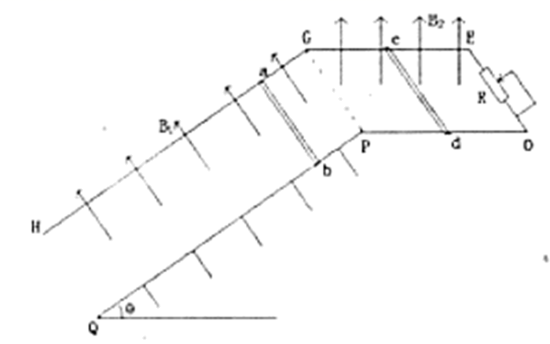

# Physics - 题目 1858

**ID**: 011b5ea962a64083a2067ccc2fe6322a
**年级**: Grade 12
**难度**: Medium-Hard
**题型**: Calculation

## 题目
如图所示，EGH与OPQ是足够长的平行导轨，导轨间的距离 $L=0.5{\rm{m}}$ ，EG、OP部分水平而粗糙，E、O端用导线与最大阻值为 $R=10{\rm{Ω}}$ 的滑动变阻器连接，GH、PQ部分倾斜且光滑，倾角为 $θ=30{}^\circ $ 。​​​​​​​‌GH、PQ导轨所在空间有垂直导轨平面向上的匀强磁场 $B{{}_{1}}=1{\rm{T}}$ ，EG、OP导轨所在处有竖直向上的匀强磁场 $B{{}_{2}}=0.6{\rm{T}}$ 。ab、cd是完全相同的导体棒，长度等于导轨间的距离，质量 $m=0.2{\rm{k}}{\rm{g}}$ ，电阻 $R=1{\rm{Ω}}$ 。现将滑动变阻器有效电阻调为 $R{{}_{1}}=1{\rm{Ω}}$ ，cd棒放在水平导轨上。ab棒从倾斜导轨上由静止释放，ab、cd与导轨接触良好，导轨和导线的电阻不计，取 $g=10{\rm{m}}/{\rm{s}}{^{2}}$ 。(1)若ab棒在下滑的过程中cd棒保持静止不动，求ab棒下滑的最大速度；(2)若cd棒与导轨间的动摩擦因数为 $μ=0.24$ （已知最大静摩擦力等于滑动摩擦力），为保证释放ab棒后cd棒一直不动，滑动变阻器的有效电阻 $R{{}_{2}}$ 应满足的条件。

## 解答

1. (1)ab棒由静止释放后先加速下滑，加速度减小到0时开始匀速下滑并达到最大速度v_{m}
2. mgsinθ=B_{1}IL
3. B_{1}Lv_{m}=IR_{总}
4. v_{m}=6m/s
5. (2)要保证释放ab棒后cd棒一直不动，则cd棒受的安培力不得超过最大静摩擦力设通过cd的最大电流为
6. B_{2}I_{cd}L=μmg
7. ab棒达到匀速后，cd棒与滑动变阻器的电流之和不变，滑动变阻器的电阻R_{2}越大，通过cd棒的电流越大，通过滑动变阻器的电流越小，所以滑动变阻器的电阻R_{2}有最大值R_{max}，滑动变阻器的电流有最小值I_{min}，
8. I_{cd}+I_{min }=I
9. I_{cd}R_{0}=I_{min}R_{max}
10. 解得：
11. R_{max}=4Ω
12. 所以
13. R_{2}≦4Ω

## 知识点

**中文**:
  - 双杆模型
  - 导体切割磁感线产生感应电动势（电流）的分析与计算

**English**:
  - Double Rod Model
  - Analysis and Calculation of Cutting Magnetic Field Lines

---
