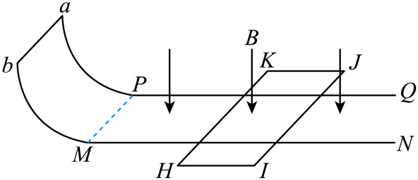

# Physics - 题目 2555

**ID**: 018fefc2c83f4e6f85d6e5fdc0b34bc1
**年级**: Grade 12
**难度**: Medium-Hard
**题型**: Calculation

## 题目
如图所示，两足够长平行金属直导轨MN、PQ的间距L= 0.5 m，固定在同一水平面内，直导轨在左端M、P点分别与两条半径r= 0.45 m的竖直 $\frac {1}{4}$ 圆弧固定导轨相切。​​​​​​​‌MP连线与直导轨垂直，其左侧无磁场，右侧存在磁感应强度大小为B= 1 T、方向竖直向下的匀强磁场。长L= 0.5 m、质量m= 1 kg、电阻R= 2 Ω的金属棒ab跨放在两圆弧导轨的最高点。质量m′ = 4 kg、电阻R′ = 12 Ω的均匀金属丝制成一个金属长方形HIJK，其长为1 m，宽为0.5 m，水平放置在两直导轨上，金属长方形的中心到两直导轨的距离相等，且HI与导轨平行。忽略导轨的电阻、所有摩擦以及金属长方形的可能形变，金属棒、金属长方形均与导轨始终接触良好，取重力加速度g= 10 m/s^{2}。现将金属棒ab由静止释放，运动过程中金属棒始终不与金属长方形接触，求：（1）金属棒刚越过MP时产生的感应电动势大小；（2）金属长方形刚开始运动时的加速度大小；（3）开始到稳定过程中金属长方形产生的焦耳热。

## 解答

1. （1）金属棒由静止释放到刚越过MP过程中，由动能定理有 $mgr=\frac {1}{2}mv{{}_{0}^{2}}$ ，
2. 解得 $v{{}_{0}}=3{\rm{m}}{\rm{/}}{\rm{s}}$ ，
3. 金属棒刚越过MP时产生的感应电动势大小为 $E=BLv{{}_{0}}$ ，
4. 解得 $E=1.5{\rm{V}}$ 。
5. （2）根据题意可知，金属长方形在导轨间两段金属丝并联接入电路中，轨道外侧的金属丝被短路，由几何关系可得每段接入电路的金属丝阻值为 $R{{}_{0}}=\frac {1}{2}\times \frac {R^{′}}{3}$ ，
6. 整个回路的总电阻为 $R{{}_{总}}=R+\frac {R{{}_{0}}}{2}$ ，
7. 金属棒刚越过MP时，通过金属棒的感应电流为 $I=\frac {E}{R{{}_{总}}}$ ，
8. 对金属长方形，由牛顿第二定律有 $2BL\cdot \frac {I}{2}=m^{′}a$ ，
9. 解得 $a=0.0625{\rm{m}}{\rm{/}}{\rm{s}}{^{2}}$ 。
10. （3）根据题意，结合上述分析可知，金属长方形和金属棒所受的安培力等大反向，由动量守恒定律有 $mv{{}_{0}}=\left ({m+m^{′}}\right )v$ ，
11. 由能量守恒定律可知回路中产生的总焦耳热 $Q=\frac {1}{2}mv{{}_{0}^{2}}-\frac {1}{2}\left ({m+m^{′}}\right )v{^{2}}$ ，
12. 由串、并联电路规律知识得金属长方形产生的焦耳热 $Q{{}_{1}}=\frac {\frac {1}{2}R{{}_{0}}}{R+\frac {1}{2}R{{}_{0}}}\times Q$ ，
13. 解得 $Q{{}_{1}}=1.2{\rm{J}}$ 。

## 知识点

**中文**:
  - 电磁感应现象中的功能问题

**English**:
  - Work-Energy Problems in EM Induction

---
