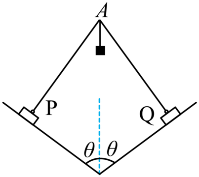

# Physics - 题目 1356

**ID**: 01f925a8f2f3420f86e284cd71d2bb92
**年级**: Grade 12
**难度**: Medium-Hard
**题型**: Calculation

## 题目
如图所示，对称、粗糙斜面与竖直方向夹角 $θ=53{^{\circ }}$ ，硬质轻杆通过铰链与两个相同且质量为 $m{{}_{1}}=2.0{\rm{k}}{\rm{g}}$ 的物块P、Q相连，对称放在斜面上，一质量 $m{{}_{2}}=3.2{\rm{k}}{\rm{g}}$ 的物体悬挂在铰链A上，对称调节P、Q的位置，使杆与斜面垂直，整个装置处于平衡状态，设最大静摩擦力等于滑动摩擦力， $g=10{\rm{m}}{\rm{/}}{\rm{s}}{^{2}}$ ， $\sin 53{^{\circ }}=0.8,{\cos}53{^{\circ }}=0.6$ ，求：（1）杆对物块P的作用力大小；（2）物块与斜面间动摩擦因数 $μ$ 的最小值；（3）若斜面光滑，对称调节P、Q的位置，使整个装置仍处于平衡状态，求此时杆与水平方向夹角的正切值。​​​​​​​‌

## 解答

1. （1）对A点进行受力分析，受绳子的拉力和两个轻杆的弹力而处于平衡状态，对绳子的拉力沿杆的方向进行分解，如图1，有
2. 
3. 所以杆对P的作用力 $F{{}_{1}}{\rm{s}}{\rm{i}}{\rm{n}}θ=\frac {1}{2}m{{}_{2}}g$
4. 代入数据可得 $F{{}_{1}}=20{\rm{N}}$
5. （2）对P进行受力分析，如图2所示
6. 
7. 当最大静摩擦力与重力在斜面上的分力相等时，动摩擦因数有最小值，设为 $μ$ ，沿杆的方向上有 $N=F{{}_{1}}+m{{}_{1}}g{\rm{s}}{\rm{i}}{\rm{n}}θ$
8. 沿斜面方向有 $f=m{{}_{1}}g{\rm{c}}{\rm{o}}{\rm{s}}θ$ ； $f=μN$
9. 联立并代入数据可得 $μ=\frac {1}{3}$
10. （3）若斜面光滑，对称调节P、Q的位置，使整个装置仍处于平衡状态，对滑块P进行受力分析如图3所示，设 $F{{}_{{{2}}}}$ 与水平方向夹角为α
11. 
12. 水平方向上 $F{{}_{2}}{\rm{c}}{\rm{o}}{\rm{s}}α=N^{′}{{\rm{c}}}{\rm{o}}{\rm{s}}θ$
13. 竖直方向上 $F{{}_{2}}{\rm{s}}{\rm{i}}{\rm{n}}α+m{{}_{1}}g=N^{′}{{\rm{s}}}{\rm{i}}{\rm{n}}θ$
14. 对A点进行受力分析，同理可得 $F{{}_{2}}{\rm{s}}{\rm{i}}{\rm{n}}α=\frac {1}{2}m{{}_{2}}g$
15. 联立可得 ${\rm{t}}{\rm{a}}{\rm{n}}α=\frac {N^{′}{{\rm{s}}}{\rm{i}}{\rm{n}}θ-m{{}_{1}}g}{N^{′}{{\rm{c}}}{\rm{o}}{\rm{s}}θ}$
16. 代入数据可得 ${\rm{t}}{\rm{a}}{\rm{n}}α=\frac {16}{27}$

## 知识点

**中文**:
  - 用正交分解法分析问题

**English**:
  - Problem Analysis using Orthogonal Decomposition

---
