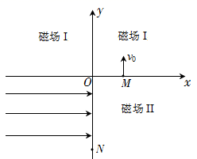

# Physics - 题目 2391

**ID**: 032c1e05fa534db4bd3be91b731aed53
**年级**: Grade 12
**难度**: Medium-Hard
**题型**: Calculation

## 题目
如图所示，在第一、二象限内存在垂直xoy平面向里、磁感应强度大小为B_{0}的匀强磁场I，第三象限内存在沿x轴正方向的匀强电场，第四象限内存在垂直于xoy平面向里的匀强磁场II。​​​​​​​‌一质量为m、电荷量为+q的粒子，从x轴上M（l，0）点以某一初速度沿y轴正方向进入第一象限， 先以原点O为圆心做圆周运动，随后进入第三象限，在电场中运动一段时间后，经y轴上的N（0， $-\frac {8}{3}l$ ）点进入第四象限，在磁场II运动的过程中，恰好不进入第一象限。不计粒子重力，求∶（1）带电粒子从M点进入第一 象限时初速度v_{0}的大小；（2）电场强度E的大小；（3）磁场II的磁感应强度B的大小。

## 解答

1. （1）在第一、二象限，粒子做半径为 $l$ 的圆周运动，由
2. $qv{{}_{0}}B{{}_{0}}=\frac {mv{{}_{0}^{2}}}{l}$
3. 解得
4. $v{{}_{0}}=\frac {qB{{}_{0}}l}{m}$
5. 
6. （2）粒子在第三象限做类平抛运动，初速度为 $v{{}_{0}}$ ，运动到 $N$ 点过程中沿电场方向通过的位移大小为 $l$ ，垂直电场方向通过的位移大小为 $\frac {8}{3}l$ ，由运动学规律可得：加速度
7. $a=\frac {qE}{m}$
8. $\frac {8}{3}l=v{{}_{0}}t$
9. $l=\frac {1}{2}at{^{2}}$
10. 解得
11. $E=\frac {9qB{{}_{0}^{2}}l}{32m}$
12. （3）设拉子经过 $N$ 点时速度方向与 $y$ 轴负方向的夹角 $θ$
13. ${\tan}θ=\frac {l}{\frac {4}{3}l}$
14. 解得
15. $θ=37{}^\circ $
16. 设粒子进入第四象限时的速度大小为 $v$
17. $v=\frac {v{{}_{0}}}{{\cos}θ}$
18. 解得
19. $v=\frac {5}{4}v{{}_{0}}$
20. 由于粒子恰好不进入第一象限，轨迹如图所示
21. $R(1+{\sin}θ)=ON$
22. $R=\frac {5}{3}l$
23. 由
24. $qvB=\frac {mv{^{2}}}{R}$
25. 解得
26. $B=\frac {3}{4}B{{}_{0}}$

## 知识点

**中文**:
  - 带电粒子在有界磁场中运动的临界极值问题
  - 带电粒子在组合场中的运动
  - 求解平抛运动、类平抛运动问题

**English**:
  - Critical Extremum Problems in Bounded Magnetic Fields
  - Motion in Combined Fields
  - Solving Horizontal and Quasi-Horizontal Projectile Problems

---
