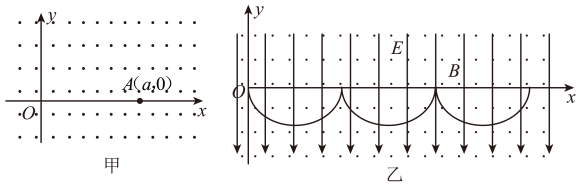

# Physics - 题目 1285

**ID**: 035f1b238be84de0a8904c6adaab45e5
**年级**: Grade 12
**难度**: Medium-Hard
**题型**: Calculation

## 题目
如甲所示，空间存在一范围足够大、方向垂直于竖直平面xOy向里的匀强磁场，磁感应强度大小为B。​​​​​​​‌让质量为m，电荷量为q（q>0）的粒子从坐标原点O沿xOy平面入射。不计粒子重力，重力加速度力g。（1）若该粒子沿y轴负方向入射后，恰好能经过x轴上的A（a，0）点，求粒子速度v_{0}的大小；（2）若该粒子以速度v沿y轴负方向入射的同时，一不带电的小球从x轴上方某一点平行于x轴向右抛出，二者经过时间 $t=\frac {2πm}{3qB}$ 恰好相遇，求小球抛出点的纵坐标；（3）如图乙所示，在此空间再加入沿y轴负方向、大小为E的匀强电场，让该粒子改为从O点静止释放，研究表明：粒子在xOy平面内将做周期性运动，其周期 $T=\frac {2πm}{qB}$ ，且在任一时刻，粒子速度的水平分量vx与其所在位置的y轴坐标绝对值的关系为 $v{{}_{x}}=\frac {qB}{m}y$ 。若在粒子释放的同时，另有一不带电的小球从x轴上方某一点平行于x轴向右抛出，二者经过时间 $t=\frac {3πm}{qB}$ 恰好相遇，求小球抛出点的纵坐标。

## 解答

1. 解：(1)由题意可知，粒子做匀速圆周运动的半径为 $r{{}_{1}}$ ，有： $r{{}_{1}}=\frac {a}{2}$
2. 洛伦兹力提供向心力，有： $qv{{}_{0}}B=m\frac {v{{}_{0}^{2}}}{r{{}_{1}}}$
3. 解得： $v{{}_{0}}=\frac {qBa}{2m}$
4. (2)洛伦兹力提供向心力，又有： $qvB=m\frac {v{^{2}}}{r{{}_{2}}}$
5. 解得： $r{{}_{2}}=\frac {mv}{qB}$
6. 粒子做匀速圆周运动的周期为T，有： $T=\frac {2πr{{}_{2}}}{v}=\frac {2πm}{Bq}$
7. 则相遇时间为： $t=\frac {2πm}{3Bq}=\frac {T}{3}$
8. 在这段时间粒子转动的圆心角为 $θ$ ，有： $θ=\frac {1}{3}\times 360{}^\circ =120{}^\circ $
9. 如图所示，相遇点的纵坐标绝对值为： $r{{}_{2}}{\sin}60{}^\circ =\frac {\sqrt {3}mv}{2Bq}$
10. 小球抛出点的纵坐标为： $y=\frac {1}{2}g{\left({\frac {2πm}{3Bq}}\right)^{2}}-\frac {\sqrt {3}mv}{2Bq}$
11. 
12. (3)相遇时间： $t=\frac {3πm}{qB}=\frac {3}{2}T$
13. 由对称性可知相遇点在第二周期运动的最低点
14. 设粒子运动到最低点时，离 $x$ 轴的距离为 ${\rm{y}}{{}_{{\rm{m}}}}$ ，水平速度为 $v{{}_{x}}$
15. 由动能定理，有： $qEy{{}_{{\rm{m}}}}=\frac {1}{2}mv{{}_{x}^{2}}$
16. 联立解得： $y{{}_{{\rm{m}}}}=\frac {2mE}{qB{^{2}}}$
17. 故小球抛出点的纵坐标为： $y=\frac {1}{2}g{\left({\frac {3πm}{Bq}}\right)^{2}}-\frac {2mE}{B{^{2}}q}$

## 知识点

**中文**:
  - 带电粒子在匀强磁场中的运动
  - 带电粒子在叠加场中的运动

**English**:
  - Motion of Charged Particles in Uniform Magnetic Field
  - Motion in Superimposed Fields

---
